# StyleRadar Backend

StyleRadar es una plataforma web que conecta a compradores con almacenes de moda locales en Bogotá. Los almacenes publican su inventario con fotografías, tallas y disponibilidad, y los usuarios pueden buscar prendas, encontrar tiendas cercanas, crear playlists de estilo y vender ropa de segunda mano. Este repositorio contiene la API REST del sistema, construida con Spring Boot y PostgreSQL.

**Despliegues**

- QA: https://styleradar-backend-qa.azurewebsites.net/swagger-ui/index.html
- PROD: https://styleradar-backend-prod.azurewebsites.net/swagger-ui/index.html

## Índice

- [Ejecución de pruebas](#ejecución-de-pruebas)
- [Cómo levantar el proyecto localmente](#cómo-levantar-el-proyecto-localmente)
- [Variables de entorno](#variables-de-entorno)
- [Diagrama de contexto](#diagrama-de-contexto)
- [Diagrama de clases](#diagrama-de-clases)
- [Diagrama de componentes específico](#diagrama-de-componentes-específico)
- [Diagrama de componentes general](#diagrama-de-componentes-general)
- [Diagrama de base de datos](#diagrama-de-base-de-datos)
- [Diagrama de despliegue](#diagrama-de-despliegue)
- [Swagger/OpenAPI](#swaggeropenapi)
- [Roles y permisos](#roles-y-permisos)
- [Patrones de diseño](#patrones-de-diseño)
- [Decisión de persistencia](#decisión-de-persistencia)
- [CI/CD](#cicd)
- [Arquitectura implementada](#arquitectura-implementada)
- [Alcance implementado por este backend](#alcance-implementado-por-este-backend)
- [Trazabilidad funcional del Sprint 2](#trazabilidad-funcional-del-sprint-2)
- [Integrantes](#integrantes)

## Ejecución de pruebas

Las pruebas unitarias y de integración usan JUnit 5, Mockito y H2, por lo que no requieren una base de datos externa. Desde la carpeta `style-radar/`:

```shell
mvn test
mvn verify
```

`mvn verify` ejecuta las pruebas y valida con JaCoCo que la cobertura de líneas sea de al menos 85 %. Resultado actual: **1370 pruebas sin fallos y 96,1 % de cobertura de líneas**.

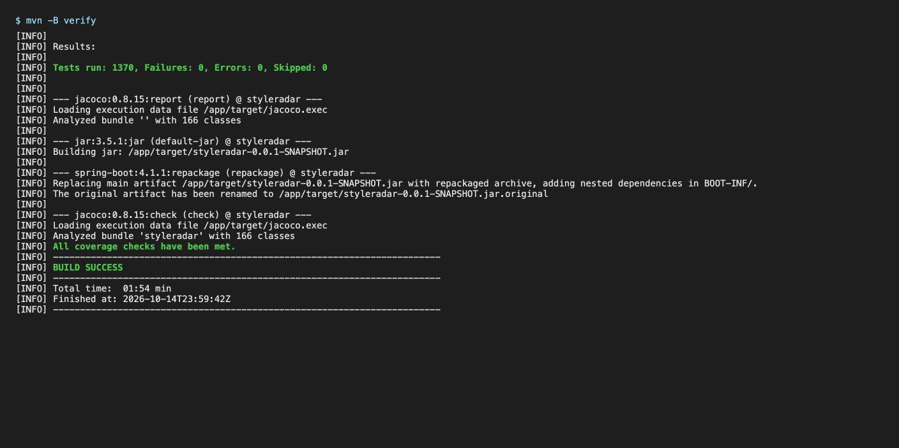

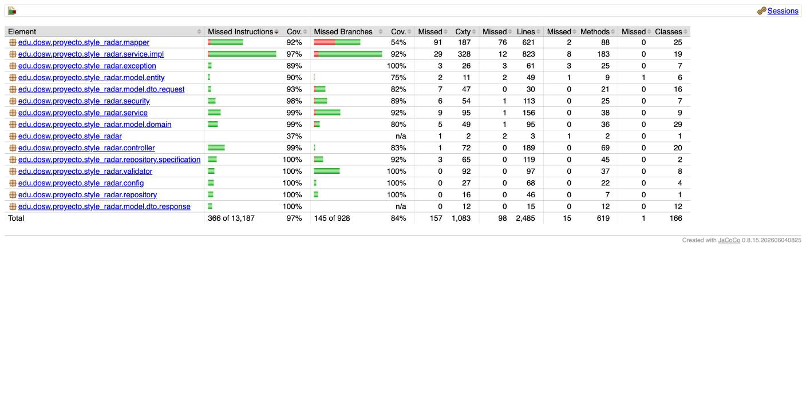

## Cómo levantar el proyecto localmente

Prerrequisitos: Java 21, Maven y Docker Desktop.

```shell
git clone https://github.com/CatrachoINXS/StyleRadar-Backend.git
cd StyleRadar-Backend/style-radar
cp .env.example .env
docker compose up --build -d
```

El archivo `docker-compose.yml` levanta la API y PostgreSQL en una red compartida, con un volumen persistente para los datos. La API queda disponible en `http://localhost:8080/swagger-ui/index.html`.

Contenedores en ejecución:

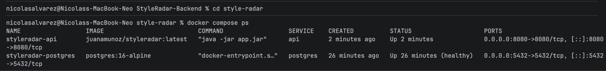

Swagger desde el contenedor:


Registro de inicio de la API con conexión a la base de datos:

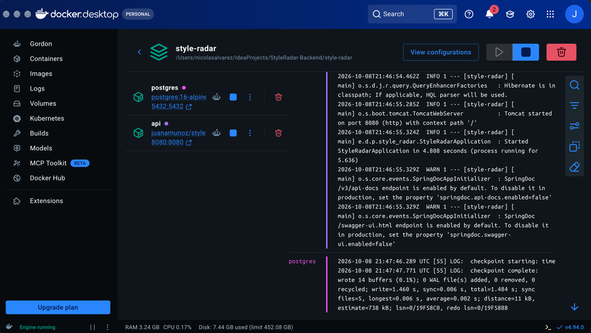

La imagen del backend está publicada en Docker Hub: [juanamunoz/styleradar](https://hub.docker.com/r/juanamunoz/styleradar).

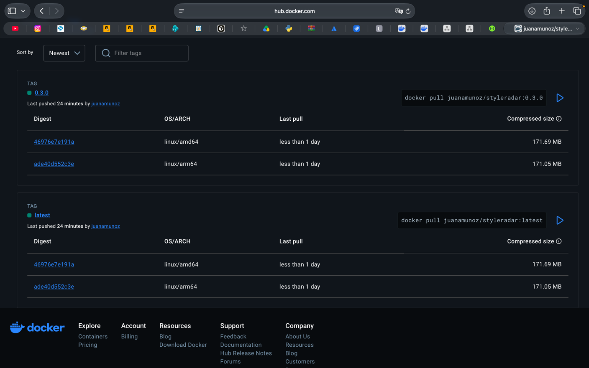

## Variables de entorno

Los valores de ejemplo están en `style-radar/.env.example`. El archivo `.env` con los valores reales no se versiona.

| Variable | Descripción | Ejemplo |
|---|---|---|
| `DB_URL` | URL JDBC de PostgreSQL. En Docker Compose se construye a partir de `DB_NAME`. | `jdbc:postgresql://localhost:5432/styleradar` |
| `DB_NAME` | Nombre de la base de datos creada por el contenedor de PostgreSQL. | `styleradar` |
| `DB_USERNAME` | Usuario de la base de datos. | `styleradar` |
| `DB_PASSWORD` | Contraseña de la base de datos. | `change-me` |
| `DB_PORT` | Puerto expuesto de PostgreSQL en la máquina local. | `5432` |
| `API_PORT` | Puerto expuesto de la API en la máquina local. | `8080` |
| `SERVER_PORT` | Puerto interno de la aplicación. | `8080` |
| `JPA_DDL_AUTO` | Estrategia de Hibernate para el esquema. | `update` |
| `JWT_SECRET_BASE64` | Clave para firmar los tokens de acceso, codificada en Base64 y de al menos 256 bits. Se puede generar con `openssl rand -base64 32`. | `change-me-base64-key` |
| `JWT_DURATION` | Tiempo de validez de los tokens de acceso. | `PT60M` |
| `CORS_ALLOWED_ORIGINS` | Orígenes del frontend permitidos, separados por coma. | `http://localhost:3000` |
| `STYLERADAR_DEMO_ENABLED` | Carga al iniciar los datos de demostración: 3 almacenes, 10 prendas, 3 planes, una fundación y un usuario por rol. No duplica datos al reiniciar. | `false` |
| `STYLERADAR_DEMO_PASSWORD` | Contraseña de los usuarios de demostración. Sin valor no se crean. | `change-me` |
| `PROBADOR_IA_API_KEY` | Clave del servicio externo de prueba virtual (FASHN). Sin valor se usa la composición local. | `change-me` |
| `PROBADOR_IA_URL` | URL base del servicio de prueba virtual. | `https://api.fashn.ai/v1` |
| `DOCKER_IMAGE` | Nombre de la imagen en Docker Hub. | `usuario/styleradar` |
| `IMAGE_TAG` | Tag de la imagen construida. | `latest` |

## Diagrama de Contexto
En el siguiente diagrama de contexto se presenta la arquitectura general y los actores que interactúan con StyleRadar.


### Actores
Como actores tenemos a los *usuarios compradores, a los almacenes de moda, a las fundaciones aliadas y al administrador*.

Cada uno de los susodichos interactúa de manera diferente en la plataforma, tal y como se menciona en el diagrama.

### Sistemas externos
Como sistemas externos están *Mapbox* para que los usuarios compradores puedan saber a donde tienen que ir para comprar su prenda. *PSE* como pasarela de pagos para las suscripciones y la *API del Probador Virtual* que se conecta a un servicio de IA para generar una imagen del usuario comprador con determinada prenda.

## Diagrama de clases


#### Estructura general del diagrama de clases
En color azul se encuentra lo relacionado con los usuarios y los almacenes. La clase `Usuario` guarda sus roles, el estado de la cuenta, las preferencias de estilo y las tallas habituales, y se relaciona con sus búsquedas guardadas. La clase `Almacen` contiene la información de contacto, la ubicación, la reputación y las categorías de cada tienda.

En color amarillo se agrupa lo referente a las prendas. `Prenda` describe la prenda; `ItemCatalogo` representa su publicación en el catálogo de un almacén, con su inventario por talla (`InventarioTalla`) y sus imágenes (`ImagenCatalogo`). También se encuentran las publicaciones de segunda mano (`PublicacionSegundaMano`).

En color verde se encuentran las Playlists de estilo, que agrupan varias prendas y registran los usuarios que les dan me gusta. En color morado están las alertas que crea un usuario y las notificaciones que estas generan, y en color naranja las suscripciones de los almacenes y sus planes.

## Diagrama de componentes específico


#### Módulos
Cada módulo se encarga de una parte específica de la plataforma:
- **Autenticación:** inicio de sesión y manejo de credenciales.
- **Usuarios:** registro, perfil, preferencias, búsquedas guardadas y gestión del estado de las cuentas.
- **Almacenes:** información de los almacenes, verificación, administradores asociados y búsqueda por distancia.
- **Catálogo:** publicación de prendas, inventario por talla, imágenes y moderación del catálogo.
- **Búsqueda y personalización:** búsqueda con filtros, prendas similares y recomendaciones personalizadas.
- **Segunda mano:** publicación, búsqueda, edición y venta de prendas usadas entre usuarios.
- **Playlists:** creación de playlists de estilo, gestión de sus prendas e interacción de otros usuarios.
- **Alertas:** alertas de disponibilidad y notificaciones para los usuarios.
- **Suscripciones:** planes y suscripciones de los almacenes.

Además, existen componentes transversales para la seguridad (`SecurityConfig`, `JwtAuthFilter`, `JwtUtil`), el manejo uniforme de errores (`GlobalExceptionHandler`), la documentación de la API (`SwaggerConfig`) y el manejo del tiempo (`TimeConfig`).

#### Estructura de los módulos
En cada módulo, el `Controller` recibe la solicitud y usa un `Mapper` para convertir los datos recibidos en objetos del dominio. El Controller depende de la interfaz del servicio (por ejemplo `IUsuarioService`), que es implementada por el `Service`. El Service aplica la lógica de negocio apoyándose en los `Validator` y calculadores, usa el `EntityMapper` para convertir los objetos del dominio en entidades y se comunica con el `Repository`, que accede a la base de datos.

## Diagrama de componentes general


Los actores (usuario comprador, almacén, fundación aliada y administrador) usan el ***Front-End***, una aplicación web que consume la API REST del ***Back-End*** en la ruta `/api/v1`. El Back-End, construido con Spring Boot, contiene la lógica de negocio y la seguridad con JWT y roles, y almacena la información en la ***Base de Datos*** PostgreSQL por medio de JDBC. Además, el sistema contempla la integración con tres sistemas externos: Mapbox para mapas y ubicación, PSE para los pagos y la API del probador virtual basada en IA.

## Diagrama de base de datos


#### Estructura de la base de datos
En color azul se encuentran los usuarios y los almacenes. La tabla `usuarios` se relaciona con sus roles, sus credenciales, sus preferencias de estilo, sus tallas habituales y sus búsquedas guardadas. La tabla `almacenes` se identifica por el NIT y se relaciona con sus categorías y con los usuarios que la administran.

En color amarillo se agrupa todo lo relacionado con las prendas. Cada prenda que un almacén publica se registra en `items_catalogo`, que a su vez guarda el inventario por talla, las imágenes y el control de disponibilidad. Las publicaciones de ropa de segunda mano se registran en `publicaciones_segunda_mano`, junto con sus fotos.

En color verde se encuentran las playlists de estilo, con las prendas que contienen y los usuarios que les dan me gusta. En color morado están las alertas y las notificaciones de cada usuario, y en color naranja los planes y las suscripciones de los almacenes.

La justificación de la base de datos elegida se encuentra en la sección [Decisión de persistencia](#decisión-de-persistencia).

## Diagrama de despliegue


#### Descripción del despliegue
- **Equipo del desarrollador:** desde aquí se suben los cambios al repositorio de GitHub.
- **GitHub:** contiene el repositorio y el entorno de ejecución de GitHub Actions, donde se ejecutan los pipelines `ci-qa.yml` y `ci-prod.yml`. Ambos compilan y prueban el proyecto, generan el artefacto `styleradar.jar` y construyen la imagen Docker.
- **Docker Hub:** almacena la imagen `juanamunoz/styleradar` con sus tags de QA y de versión.
- **Microsoft Azure:** cada ambiente (QA y producción) tiene su propio App Service, que ejecuta el contenedor Docker con el artefacto `app.jar` y las variables de entorno definidas en sus App Settings, y su propia base de datos PostgreSQL. La comunicación entre la aplicación y la base de datos se realiza por JDBC con conexión cifrada.
- **Equipo del usuario:** accede a la API desde el navegador por HTTPS.

El despliegue en producción requiere además una aprobación manual en GitHub.

## Swagger/OpenAPI

Con la aplicación en ejecución, la interfaz y el documento OpenAPI están disponibles en:

- `/swagger-ui.html`
- `/v3/api-docs`

Las interfaces del paquete `controller/docs` describen únicamente los endpoints implementados de prendas, catálogo, inventario, imágenes y búsqueda.

## Roles y permisos

El sistema maneja cuatro roles: `COMPRADOR`, `ADMIN_ALMACEN`, `REPRESENTANTE_FUNDACION` y `ADMIN_STYLERADAR`. Los permisos se definen en `SecurityConfig`:

| Endpoints | Métodos | Acceso |
|---|---|---|
| `/api/v1/auth/login`, `/api/v1/auth/registro`, `/api/v1/usuarios` | POST | Público |
| `/api/v1/prendas`, `/api/v1/catalogo/buscar`, `/api/v1/almacenes`, `/api/v1/almacenes/{nit}/catalogo`, `/api/v1/almacenes/{nit}/catalogo/resumen`, `/api/v1/almacenes/{nit}/catalogo/novedades`, `/api/v1/almacenes/{nit}/distancia`, `/api/v1/planes-suscripcion` | GET | Público |
| `/swagger-ui/**`, `/v3/api-docs/**` | GET | Público |
| `/api/v1/almacenes/{nit}/suscripciones`, `/api/v1/almacenes/{nit}/suscripciones/vigente`, `/api/v1/almacenes/{nit}/suscripciones/{id}/renovacion` | GET, POST, PATCH | `ADMIN_ALMACEN` |
| `/api/v1/admin/usuarios`, `/api/v1/admin/usuarios/{id}`, `/api/v1/admin/usuarios/{id}/estado` | GET, PATCH | `ADMIN_STYLERADAR` |
| `/api/v1/admin/almacenes/verificacion`, `/api/v1/admin/almacenes/{nit}/verificacion`, `/api/v1/admin/almacenes/{nit}/verificacion/solicitar-revision` | GET, PATCH, POST | `ADMIN_STYLERADAR` |
| `/api/v1/admin/almacenes/{nit}/administradores/{usuarioId}` | PUT | `ADMIN_STYLERADAR` |
| `/api/v1/admin/catalogo/moderacion`, `/api/v1/admin/catalogo/{itemId}/moderacion`, `/api/v1/admin/catalogo/{itemId}/moderacion/solicitar-revision` | GET, PATCH, POST | `ADMIN_STYLERADAR` |
| `/api/v1/admin/fundaciones/**` (registrar, editar, desactivar) | POST, PUT, PATCH, GET | `ADMIN_STYLERADAR` |
| `/api/v1/usuarios/me`, `/me/preferencias-estilo`, `/me/tallas-habituales`, `/me/busquedas-guardadas/**` | GET, PUT, POST, DELETE | `COMPRADOR` |
| `/api/v1/usuarios/{id}` | GET | `ADMIN_STYLERADAR` |
| `POST /api/v1/segunda-mano`, `/api/v1/usuarios/me/segunda-mano/**` (editar, vender, donar, retirar) | POST, PUT, PATCH, DELETE | `COMPRADOR` (propietario) |
| `POST /api/v1/playlists`, `/api/v1/usuarios/me/playlists/**`, `/api/v1/playlists/{id}/like`, `/guardar`, `/api/v1/usuarios/me/playlists-guardadas` | GET, POST, PUT, DELETE | `COMPRADOR` |
| `GET /api/v1/segunda-mano`, `GET /api/v1/segunda-mano/{id}`, `GET /api/v1/playlists`, `/api/v1/playlists/{id}`, `/api/v1/playlists/populares` | GET | Cualquier usuario autenticado |
| `/api/v1/segunda-mano/{id}/conversaciones`, `/api/v1/conversaciones/**`, `/api/v1/usuarios/me/conversaciones` | GET, POST | `COMPRADOR` (solo participantes del chat) |
| `/api/v1/usuarios/me/probador/**` | GET, POST, DELETE | `COMPRADOR` |
| `GET /api/v1/fundaciones` (cercanas), `/api/v1/usuarios/me/donaciones` | GET, POST | `COMPRADOR` |
| `/api/v1/fundaciones/mi-fundacion/solicitudes/**` (consultar, decidir, recepción) | GET, PATCH | `REPRESENTANTE_FUNDACION` |
| `PATCH /api/v1/donaciones/{id}/recogida` | PATCH | `COMPRADOR` (donante) o `REPRESENTANTE_FUNDACION` (solo participantes) |
| Resto de endpoints (alertas, notificaciones, feed y gestión del catálogo) | Todos | Cualquier usuario autenticado con JWT. Los servicios validan además que el usuario sea el dueño del recurso o administrador del almacén correspondiente |

Las peticiones sin token reciben `401` y las que no tienen el rol requerido reciben `403`. Cada endpoint de usuarios, segunda mano, playlists, fundaciones, donaciones, probador y chat declara `@PreAuthorize` en su interfaz `controller/docs/*Api`; en las rutas `/me` el usuario sale siempre del JWT, nunca de la URL. CORS solo admite los orígenes de `CORS_ALLOWED_ORIGINS`. Al registrar una fundación, su representante recibe el rol `REPRESENTANTE_FUNDACION`.

## Patrones de diseño

| Patrón | Problema que resuelve | Clase concreta | Diagrama |
|---|---|---|---|
| Repository | Separa el acceso a la base de datos de la lógica de negocio. | `ItemCatalogoRepository`, `UsuarioRepository` | Componentes específico |
| Specification | Permite combinar filtros de búsqueda opcionales (tipo, color, talla, precio, marca, estilo) sin escribir una consulta para cada combinación. | `ItemCatalogoSpecifications`, `PublicacionSegundaManoSpecifications` | Componentes específico (Búsqueda y Segunda mano) |
| Data Mapper | Convierte los datos entre DTO, objetos del dominio y entidades sin mezclar esa lógica en los servicios. | `CatalogoItemMapper`, `ItemCatalogoEntityMapper` | Componentes específico |
| Chain of Responsibility | Procesa la autenticación de cada petición mediante una cadena de filtros de seguridad. | `JwtAuthFilter` dentro de la cadena configurada en `SecurityConfig` | Componentes específico (Seguridad) |
| Inyección de dependencias | Los controladores dependen de interfaces y no de implementaciones concretas, lo que facilita las pruebas y el cambio de implementación. | `ICatalogoService` implementada por `CatalogoServiceImpl` | Componentes específico (interfaces entre Controller y Service) |
| Builder | Facilita la creación de objetos con muchos atributos opcionales. | `UsuarioEntity`, `PlaylistEntity` | Base de datos |

### Diseño propuesto

Las siguientes ilustraciones conservan las propuestas de diseño del producto. Su presencia no implica que exista una implementación en el alcance actual del backend.

#### Strategy — diseño propuesto, no implementado

La propuesta plantea algoritmos intercambiables para sugerencias del feed. El módulo actual no implementa un feed, una interfaz Strategy ni estrategias concretas.


#### Observer — diseño propuesto, no implementado

La propuesta contempla notificaciones a compradores cuando se publica una prenda. En el código actual no existen el sujeto, los observadores ni las clases `PublicaciónPrenda` y `UsuarioComprador` descritas originalmente.


#### Adapter — implementado en el probador virtual

El probador virtual depende de la interfaz `ProbadorIA`, y `FashnProbadorIA` la adapta a la API externa de prueba virtual de FASHN: envía la foto del usuario y la de la prenda, consulta el estado de la ejecución y devuelve la imagen generada. `ProbadorVirtualServiceImpl` no conoce los detalles del proveedor; si el servicio no está configurado o no responde, genera la composición local con `ComposicionProbador`. La adaptación de pasarelas de pago sigue como diseño propuesto.


#### Composite — composición del framework, no patrón propio implementado

La búsqueda combina filtros con `Specification<ItemCatalogoEntity>` de Spring Data JPA en `ItemCatalogoSpecifications`. Esa composición permite unir predicados con AND y OR, pero el proyecto no define una jerarquía Composite propia como `FiltroTalla`, `FiltroColor` o `FiltroCompuestoAnd`. La ilustración se conserva como diseño conceptual.

El patrón composite nos resuelve el problema de la combinacion de filtros en las búsquedas inteligentes. Con este patrón podemos crear filtros simples como `FiltroTalla` o `FiltroColor`, y filtros complejos como `FiltroCompuestoAnd` (que combina dos filtros) y tratarlos de la misma forma. De esta forma, evaluar si una prenda cumple con un filtro de búsqueda complejo, se vuelve más sencillo. 


#### Iterator — diseño propuesto, no implementado

El código utiliza colecciones, streams y mecanismos de iteración provistos por Java y Spring Data. No existe un iterador personalizado del dominio; la ilustración representa una posibilidad de diseño, no el estado del código.


## Decisión de persistencia

Se eligió PostgreSQL, una base de datos relacional, porque la información de StyleRadar está muy conectada entre sí: un almacén tiene muchas prendas publicadas, cada prenda tiene inventario por talla e imágenes, y los usuarios crean playlists y publicaciones que hacen referencia a esas mismas prendas. Un modelo relacional permite representar estas relaciones de forma directa y consultar la información combinada, por ejemplo al buscar prendas con filtros por talla, precio o almacén.

Además, la base de datos ayuda a mantener la información consistente por medio de reglas propias:

- El correo de cada usuario es único.
- Una misma prenda del catálogo no puede tener dos registros de inventario para la misma talla.
- Las unidades disponibles nunca pueden ser negativas.
- Las publicaciones, los inventarios y las imágenes siempre deben estar asociados a un registro existente.
- Un almacén solo puede tener una suscripción activa a la vez.
- Un usuario no puede tener dos alertas activas sobre el mismo objetivo.

El acceso a los datos se realiza con Spring Data JPA, lo que permite trabajar con las tablas a partir de las clases del proyecto y mantener separada la lógica de negocio del manejo de la base de datos.

## CI/CD

El repositorio cuenta con dos pipelines en GitHub Actions.

**QA** (`.github/workflows/ci-qa.yml`). Cada vez que se integran cambios en las ramas `develop` o `main` se ejecutan los siguientes pasos:

1. **Pruebas y cobertura:** se ejecutan todas las pruebas y se verifica que la cobertura sea de al menos 85 %.
2. **Imagen QA:** se construye la imagen del backend y se publica en Docker Hub con los tags `qa-latest` y `qa-<commit>`.
3. **Despliegue en QA:** la nueva imagen se despliega en el App Service de QA en Azure y se comprueba que la documentación de la API responda correctamente.

Las pruebas también se ejecutan en cada pull request hacia `main` o `develop`, sin publicar ni desplegar.

**PROD** (`.github/workflows/ci-prod.yml`). Se ejecuta al publicar un tag de versión con el formato `v*.*.*`, por ejemplo `v1.0.0`:

1. **Pruebas y cobertura:** se repite la validación de las pruebas y de la cobertura mínima.
2. **Imagen de la versión:** se publica la imagen en Docker Hub con el número de versión y con el tag `latest`.
3. **Aprobación manual:** el despliegue queda en espera hasta que un revisor autorizado lo apruebe en el ambiente `production` de GitHub.
4. **Despliegue en PROD:** la imagen aprobada se despliega en el App Service de producción y se comprueba que la API responda correctamente.

El historial de ejecuciones está disponible en la pestaña [Actions](https://github.com/CatrachoINXS/StyleRadar-Backend/actions) del repositorio.

Secrets utilizados por el pipeline (los valores no se publican):

| Secret | Ámbito | Uso |
|---|---|---|
| `DOCKERHUB_USERNAME` | Repositorio | Usuario de Docker Hub. |
| `DOCKERHUB_TOKEN` | Repositorio | Token de acceso a Docker Hub. |
| `AZURE_CREDENTIALS` | Repositorio | Credenciales para desplegar en Azure. |
| `AZURE_WEBAPP_NAME_QA` | Ambiente `qa` | Nombre del App Service de QA. |
| `DB_URL_QA` | Ambiente `qa` | URL de la base de datos de QA. |
| `DB_USERNAME_QA` | Ambiente `qa` | Usuario de la base de datos de QA. |
| `DB_PASSWORD_QA` | Ambiente `qa` | Contraseña de la base de datos de QA. |
| `JWT_SECRET_QA` | Ambiente `qa` | Clave de los tokens de acceso en QA. |

En producción, la conexión a la base de datos y la clave de los tokens se configuran directamente como variables de entorno del App Service, por lo que el pipeline de PROD solo utiliza los secrets del repositorio.

### Ambientes

- **QA:** recibe automáticamente cada cambio integrado en `develop` o `main`. Se usa para validar el funcionamiento antes de publicar una versión. Tiene su propio App Service y su propia base de datos.
- **PROD:** recibe únicamente las versiones publicadas con un tag `v*.*.*` y aprobadas manualmente. Tiene su propio App Service y su propia base de datos, separados de QA.

### Evidencias

Pipeline de QA en verde:

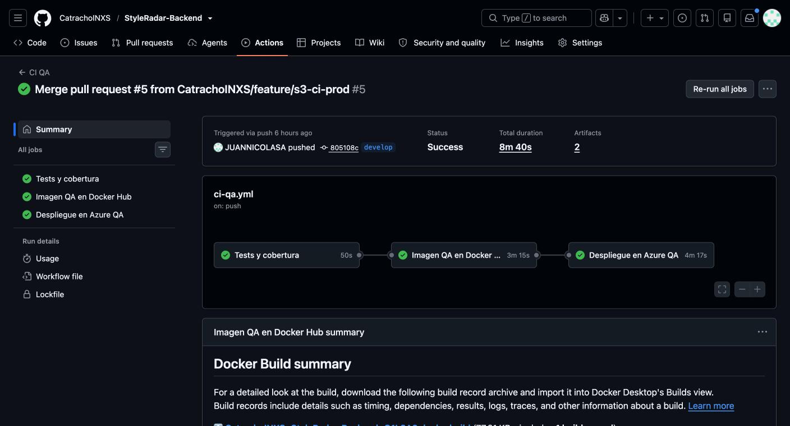

Pipeline de PROD en verde:

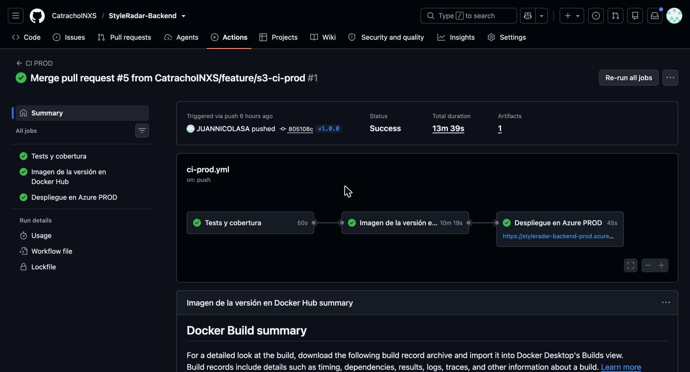

Despliegue a producción aprobado manualmente:


App Service de QA y PROD en Azure con el contenedor en ejecución:

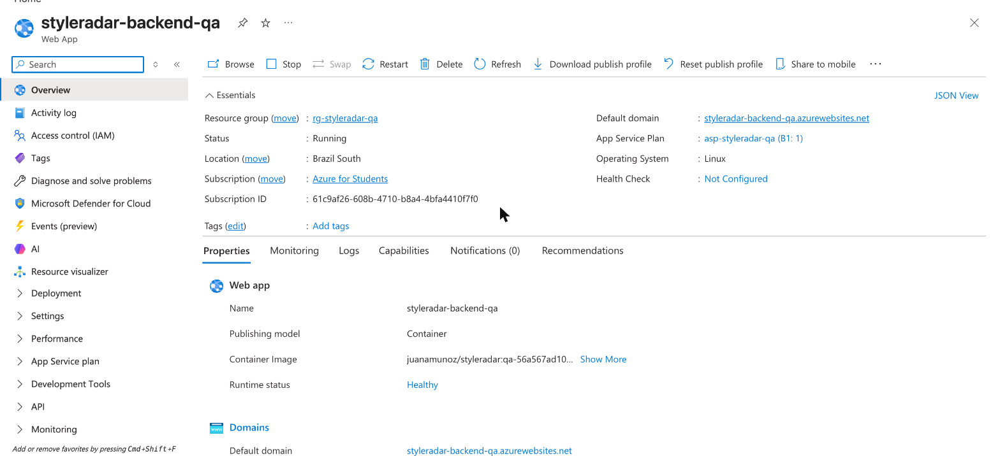

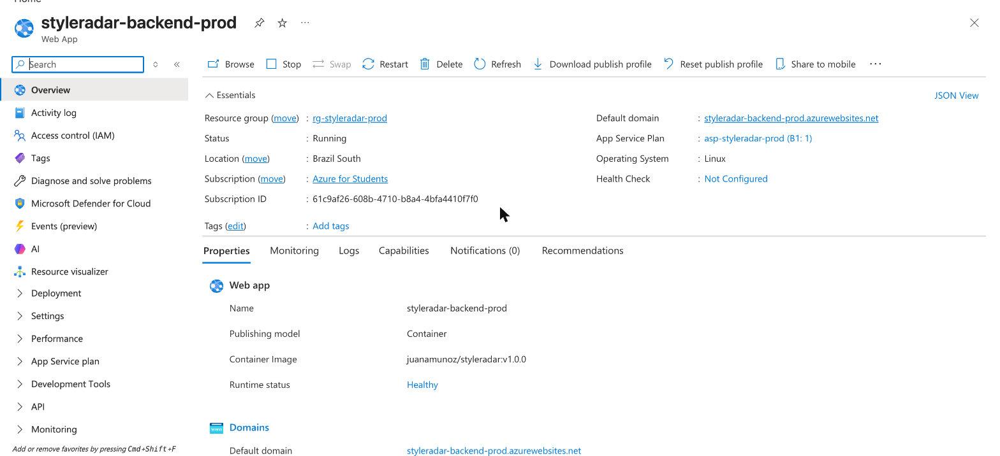

Swagger en Azure:

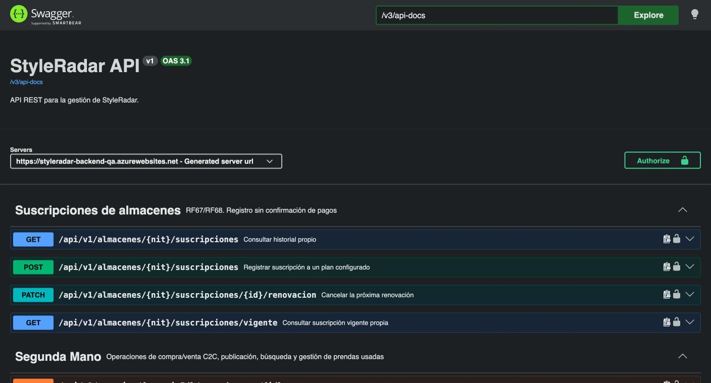

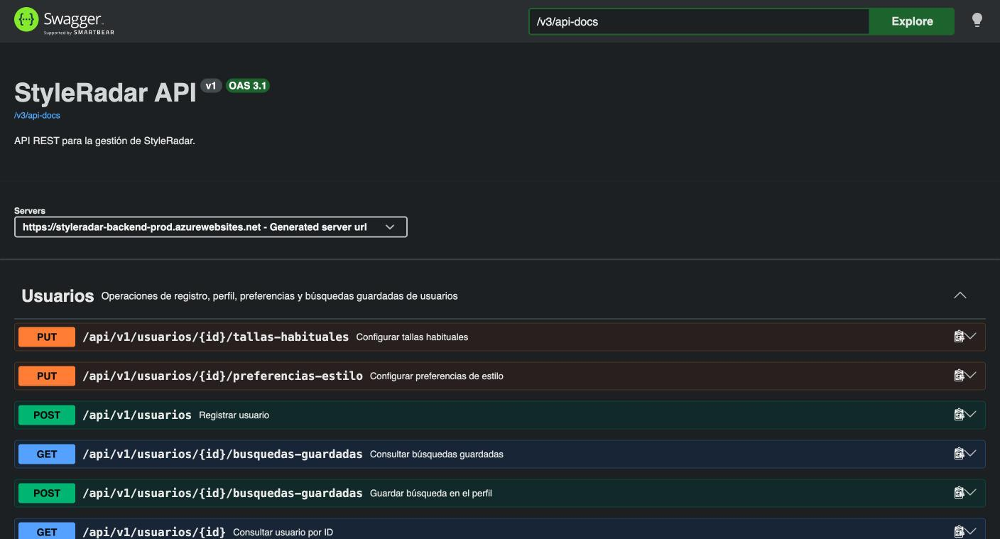

## Arquitectura implementada

El módulo mantiene una separación por responsabilidades:

1. Los `Controller` atienden HTTP y delegan la conversión de contratos a los mappers de presentación.
2. El modelo de `Domain` representa los datos usados por los casos de uso.
3. Los `Service` coordinan reglas, validadores y operaciones del módulo.
4. Los `Validator` y calculadores contienen reglas específicas de inventario, estados, distancia y similitud.
5. Los mappers de persistencia convierten entre dominio y entidades JPA.
6. Los `Repository` acceden a PostgreSQL mediante Spring Data JPA.
7. Las `Entity` representan tablas, restricciones y relaciones de persistencia.

El flujo habitual es `Controller -> Mapper -> Domain -> Service -> Validator -> Persistence Mapper -> Repository -> Entity -> PostgreSQL`; los casos simples omiten capas que no aportan transformación o reglas.

## Alcance implementado por este backend

- Publicación, consulta, edición y retiro de ítems del catálogo de un almacén.
- Inventario por talla y cálculo derivado del stock disponible.
- Registro de múltiples imágenes y respuesta basada en metadatos.
- Cálculo de estados: agotada, últimas unidades, nueva prenda y disponible.
- Búsqueda global con texto libre, filtros combinados y paginación.
- Orden por distancia y reputación del almacén.
- Fallback de prendas similares cuando una búsqueda textual no tiene coincidencias directas.

### Alcance Sprint 3 — Juan Diego Valderrama (líder técnico)

| RF | Funcionalidad | Endpoint |
|---|---|---|
| RF-23 | Cargar fotografía frontal (JPEG/PNG, ≤ 5 MB, ≥ 300x400, vertical) | `POST /api/v1/usuarios/me/probador/foto` |
| RF-24, RF-25, RF-26 | Seleccionar prenda, generar la prueba con el servicio de IA (o la composición local si no está disponible) y mostrarla (PNG) | `POST /api/v1/usuarios/me/probador/pruebas` |
| RF-27 | Eliminar la fotografía del probador | `DELETE /api/v1/usuarios/me/probador/foto` |
| RF-40 | Iniciar chat con el vendedor (sin tiempo real; WebSockets en el Corte 3) | `POST /api/v1/segunda-mano/{id}/conversaciones` |
| RF-41 | Coordinar la entrega por mensajes privados | `GET/POST /api/v1/conversaciones/{id}/mensajes` |
| RF-42 | Marcar prenda de segunda mano para donación | `PATCH /api/v1/usuarios/me/segunda-mano/{id}/donacion` |
| RF-43 | Consultar fundaciones activas cercanas, filtrables por tipo de prenda | `GET /api/v1/fundaciones` |
| RF-44, RF-45 | Seleccionar fundación y enviar la solicitud | `POST /api/v1/usuarios/me/donaciones` |
| RF-46 | Consultar solicitudes de la fundación | `GET /api/v1/fundaciones/mi-fundacion/solicitudes` |
| RF-47 | Aceptar o rechazar (motivo obligatorio al rechazar) | `PATCH /api/v1/fundaciones/mi-fundacion/solicitudes/{id}/decision` |
| RF-48 | Coordinar punto y franja de recogida | `PATCH /api/v1/donaciones/{id}/recogida` |
| RF-49 | Confirmar recepción; la prenda queda DONADA | `PATCH /api/v1/fundaciones/mi-fundacion/solicitudes/{id}/recepcion` |
| RF-63, RF-64, RF-65 | Registrar, editar y desactivar fundaciones aliadas | `/api/v1/admin/fundaciones` |
| RF-71, RNF-12 | Guardar playlist en el perfil; máximo 15 prendas por playlist | `POST /api/v1/playlists/{id}/guardar` |

Ciclo de una donación: `PENDIENTE → ACEPTADA | RECHAZADA → COORDINADA → RECIBIDA`. Una prenda solo tiene una solicitud en curso; si se rechaza, puede ofrecerse a otra fundación.

## Trazabilidad funcional del Sprint 2

Durante este Sprint se implementó el módulo de catálogo, inventario y búsqueda de StyleRadar, cubriendo los siguientes requerimientos funcionales:

| Requerimiento | Funcionalidad |
|---|---|
| RF-07 | Búsqueda de prendas mediante texto libre |
| RF-08 | Filtro de prendas por tipo |
| RF-09 | Filtro de prendas por color |
| RF-10 | Filtro de prendas por talla disponible |
| RF-11 | Filtro de prendas por rango de precio |
| RF-12 | Filtro de prendas por marca |
| RF-13 | Filtro de prendas por estilo |
| RF-14 | Ordenamiento de resultados por distancia |
| RF-15 | Ordenamiento por reputación del almacén |
| RF-16 | Consulta de prendas similares cuando no existen coincidencias directas |
| RF-22 | Consulta del catálogo de un almacén |
| RF-50 | Publicación de prendas en el catálogo |
| RF-51 | Registro de fotografías de prendas |
| RF-52 | Registro de tallas disponibles |
| RF-53 | Registro del precio de una prenda |
| RF-54 | Registro de atributos utilizados para búsqueda |
| RF-55 | Edición de prendas del catálogo |
| RF-56 | Actualización de disponibilidad por talla |
| RF-57 | Ocultamiento de prendas agotadas en resultados públicos |
| RF-58 | Retiro de prendas del catálogo |
| RF-59 | Identificación automática de últimas unidades |
| RF-60 | Identificación automática de nuevas llegadas |

### Endpoints principales

El módulo expone, entre otros, los siguientes endpoints:

```text
GET    /api/v1/prendas

GET    /api/v1/almacenes/{nit}/catalogo
POST   /api/v1/almacenes/{nit}/catalogo
PUT    /api/v1/almacenes/{nit}/catalogo/{itemId}
DELETE /api/v1/almacenes/{nit}/catalogo/{itemId}

PUT    /api/v1/almacenes/{nit}/catalogo/{itemId}/tallas
PATCH  /api/v1/almacenes/{nit}/catalogo/{itemId}/inventario/{talla}

POST   /api/v1/almacenes/{nit}/catalogo/{itemId}/imagenes

GET    /api/v1/catalogo/buscar
```

## Integrantes

| Integrante | Rol | Aporte |
|---|---|---|
| Juan Nicolás Álvarez Muñoz | Backend | Dockerización, imagen en Docker Hub, pipelines de CI/CD para QA y PROD, ambientes en Azure, diagramas (clases, componentes, base de datos y despliegue) y documentación de despliegue. |
| Daniel Valero Quiroga | Backend | Catálogo, inventario y búsqueda; autenticación con JWT; almacenes y geolocalización; personalización; alertas; moderación; verificación de almacenes; estados de cuenta; suscripciones y playlists populares. |
| Juan Diego Valderrama Gaviria | Backend | Usuarios, preferencias y búsquedas guardadas; segunda mano; playlists; configuración de PostgreSQL y JPA; manejo global de errores y configuración de Swagger. |
| Cristian Camilo Ortiz Sánchez | Diseño y documentación | Creación del repositorio, diagrama de clases inicial y diagramas de componentes iniciales. |
| Paula Alejandra Diazrama | Diseño | Diseño del producto y apoyo en la documentación del proyecto. |
