# StyleRadar Backend

StyleRadar es una plataforma web que conecta a compradores con almacenes de moda locales en Bogotá. Los almacenes publican su inventario con fotografías, tallas y disponibilidad, y los usuarios pueden buscar prendas, encontrar tiendas cercanas, crear playlists de estilo y vender ropa de segunda mano. Este repositorio contiene la API REST del sistema, construida con Spring Boot y PostgreSQL.

**Despliegues**

- QA: https://styleradar-backend-qa.azurewebsites.net/swagger-ui/index.html
- PROD: https://styleradar-backend-prod.azurewebsites.net/swagger-ui/index.html

**Video de respaldo del demo:** https://drive.google.com/file/d/1W6dklNVi8Bp8LQUx1dkGrkMlly0gRjd7/view?usp=sharing

## Índice

- [Ejecución de pruebas](#ejecución-de-pruebas)
- [Set de pruebas de funcionamiento](#set-de-pruebas-de-funcionamiento)
- [Pruebas de seguridad](#pruebas-de-seguridad)
- [Cómo levantar el proyecto localmente](#cómo-levantar-el-proyecto-localmente)
- [Variables de entorno](#variables-de-entorno)
- [Diagrama de contexto](#diagrama-de-contexto)
- [Diagrama de clases](#diagrama-de-clases)
- [Diagrama de componentes específico](#diagrama-de-componentes-específico)
- [Diagrama de componentes general](#diagrama-de-componentes-general)
- [Diagrama de base de datos](#diagrama-de-base-de-datos)
- [Diagrama de despliegue](#diagrama-de-despliegue)
- [Diagramas de secuencia](#diagramas-de-secuencia)
- [Documento de arquitectura](#documento-de-arquitectura)
- [Swagger/OpenAPI](#swaggeropenapi)
- [Roles y permisos](#roles-y-permisos)
- [Patrones de diseño](#patrones-de-diseño)
- [Decisión de persistencia](#decisión-de-persistencia)
- [CI/CD](#cicd)
- [Evidencias](#evidencias)
- [Trazabilidad funcional](#trazabilidad-funcional)
- [Limitaciones conocidas](#limitaciones-conocidas)
- [Integrantes](#integrantes)

## Ejecución de pruebas

Las pruebas unitarias y de integración usan JUnit 5, Mockito y H2, por lo que no requieren una base de datos externa. Desde la carpeta `style-radar/`:

```shell
mvn test
mvn verify
```

`mvn verify` ejecuta las pruebas y valida con JaCoCo que la cobertura de líneas sea de al menos 85 %. Resultado actual: **1490 pruebas sin fallos y 94,8 % de cobertura de líneas**.

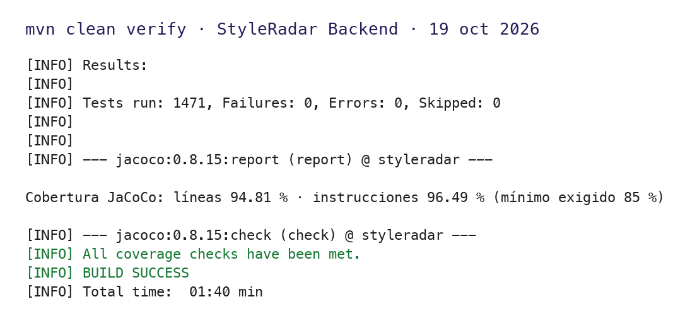

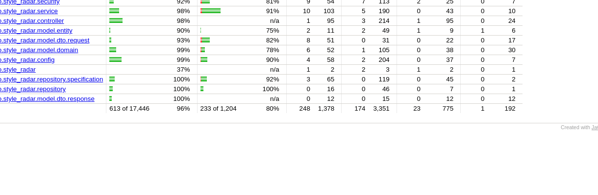

## Set de pruebas de funcionamiento

La carpeta [`postman/`](postman) contiene la colección `StyleRadar.postman_collection.json` y los ambientes Local, QA y PROD. La colección recorre la API desplegada como lo haría un usuario real.

- Tiene una carpeta por funcionalidad, con el mismo ID y nombre del análisis de requerimientos.
- Cada carpeta incluye el camino feliz y los errores relevantes: 400, 401, 403, 404, 409 y 422.
- Cada request valida el código de respuesta y los campos principales del cuerpo.

Los ambientes no contienen secretos: la contraseña de los usuarios de demostración se escribe en la variable `demoPassword` antes de ejecutar.

**Ejecución:**

1. Importar la colección y el ambiente `StyleRadar-PROD` (o `StyleRadar-QA`).
2. Escribir el valor de `demoPassword` en el ambiente.
3. Abrir el **Collection Runner**, seleccionar la colección completa y ejecutar.

Resultado contra PROD con la versión final v1.2.2, el 19 de octubre de 2026: **91 requests y 188 validaciones, sin fallas**.

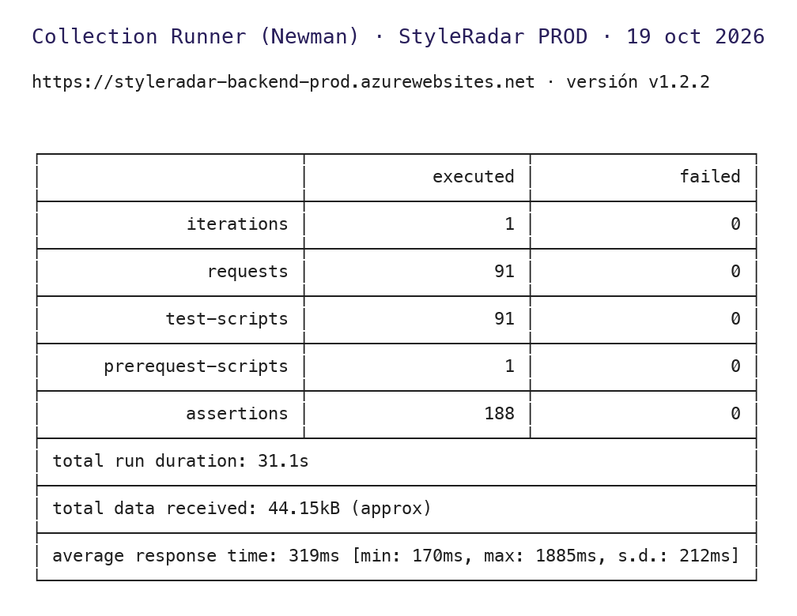

<details>
<summary><b>Tabla de casos de prueba (ejecución contra PROD)</b></summary>

| ID | Funcionalidad (RF) | Escenario | Request | Esperado | Obtenido |
|---|---|---|---|---|---|
| CP-01 | RF-02 · Iniciar sesión | Login comprador | `POST /api/v1/auth/login` | 200 | ✅ 200 |
| CP-02 | RF-02 · Iniciar sesión | Login almacen | `POST /api/v1/auth/login` | 200 | ✅ 200 |
| CP-03 | RF-02 · Iniciar sesión | Login admin | `POST /api/v1/auth/login` | 200 | ✅ 200 |
| CP-04 | RF-02 · Iniciar sesión | Login fundacion | `POST /api/v1/auth/login` | 200 | ✅ 200 |
| CP-05 | RF-02 · Iniciar sesión | Contraseña incorrecta | `POST /api/v1/auth/login` | 401 | ✅ 401 |
| CP-06 | RF-02 · Iniciar sesión | Datos inválidos | `POST /api/v1/auth/login` | 400 | ✅ 400 |
| CP-07 | RF-01 · Registrar usuario | Registro exitoso | `POST /api/v1/auth/registro` | 201 | ✅ 201 |
| CP-08 | RF-01 · Registrar usuario | Correo duplicado | `POST /api/v1/auth/registro` | 422 | ✅ 422 |
| CP-09 | RF-01 · Registrar usuario | Correo inválido | `POST /api/v1/auth/registro` | 400 | ✅ 400 |
| CP-10 | RF-01 · Registrar usuario | Login del usuario nuevo | `POST /api/v1/auth/login` | 200 | ✅ 200 |
| CP-11 | RF-03 · Configurar preferencias de estilo | Actualizar preferencias | `PUT /api/v1/usuarios/me/preferencias-estilo` | 200 | ✅ 200 |
| CP-12 | RF-03 · Configurar preferencias de estilo | Sin token | `PUT /api/v1/usuarios/me/preferencias-estilo` | 401 | ✅ 401 |
| CP-13 | RF-03 · Configurar preferencias de estilo | Estilo inválido | `PUT /api/v1/usuarios/me/preferencias-estilo` | 400 | ✅ 400 |
| CP-14 | RF-04 · Configurar tallas habituales | Actualizar tallas | `PUT /api/v1/usuarios/me/tallas-habituales` | 200 | ✅ 200 |
| CP-15 | RF-04 · Configurar tallas habituales | Talla inválida | `PUT /api/v1/usuarios/me/tallas-habituales` | 400 | ✅ 400 |
| CP-16 | RF-05 · Personalizar feed según preferencias | Feed del comprador | `GET /api/v1/usuarios/me/feed` | 200 | ✅ 200 |
| CP-17 | RF-05 · Personalizar feed según preferencias | Sin token | `GET /api/v1/usuarios/me/feed` | 401 | ✅ 401 |
| CP-18 | RF-06 · Recomendar prendas según perfil de estilo | Recomendaciones | `GET /api/v1/usuarios/me/recomendaciones` | 200 | ✅ 200 |
| CP-19 | RF-06 · Recomendar prendas según perfil de estilo | Sin token | `GET /api/v1/usuarios/me/recomendaciones` | 401 | ✅ 401 |
| CP-20 | RF-07 · Buscar prendas mediante texto libre | Buscar 'jean' | `GET /api/v1/catalogo/buscar` | 200 | ✅ 200 |
| CP-21 | RF-07 · Buscar prendas mediante texto libre | Página inválida | `GET /api/v1/catalogo/buscar` | 400 | ✅ 400 |
| CP-22 | RF-08 · Filtrar prendas por tipo | Tipo SUPERIOR | `GET /api/v1/catalogo/buscar` | 200 | ✅ 200 |
| CP-23 | RF-08 · Filtrar prendas por tipo | Tipo inexistente | `GET /api/v1/catalogo/buscar` | 400 | ✅ 400 |
| CP-24 | RF-09 · Filtrar prendas por color | Color Azul | `GET /api/v1/catalogo/buscar` | 200 | ✅ 200 |
| CP-25 | RF-10 · Filtrar prendas por talla | Talla XL | `GET /api/v1/catalogo/buscar` | 200 | ✅ 200 |
| CP-26 | RF-10 · Filtrar prendas por talla | Talla inválida | `GET /api/v1/catalogo/buscar` | 400 | ✅ 400 |
| CP-27 | RF-11 · Filtrar prendas por rango de precio | Entre 50.000 y 130.000 | `GET /api/v1/catalogo/buscar` | 200 | ✅ 200 |
| CP-28 | RF-11 · Filtrar prendas por rango de precio | Rango invertido | `GET /api/v1/catalogo/buscar` | 400 | ✅ 400 |
| CP-29 | RF-12 · Filtrar prendas por marca | Marca Sastre | `GET /api/v1/catalogo/buscar` | 200 | ✅ 200 |
| CP-30 | RF-13 · Filtrar prendas por estilo | Estilo FORMAL | `GET /api/v1/catalogo/buscar` | 200 | ✅ 200 |
| CP-31 | RF-14 · Ordenar resultados por distancia | Orden por distancia | `GET /api/v1/catalogo/buscar` | 200 | ✅ 200 |
| CP-32 | RF-14 · Ordenar resultados por distancia | Sin ubicación | `GET /api/v1/catalogo/buscar` | 400 | ✅ 400 |
| CP-33 | RF-15 · Ordenar resultados por reputación del almacén | Orden por reputación | `GET /api/v1/catalogo/buscar` | 200 | ✅ 200 |
| CP-34 | RF-16 · Consultar prendas similares cuando no exista coincidencia exacta | Búsqueda sin coincidencia exacta | `GET /api/v1/catalogo/buscar` | 200 | ✅ 200 |
| CP-35 | RF-17 · Mostrar almacenes aliados en el mapa | Listar almacenes | `GET /api/v1/almacenes` | 200 | ✅ 200 |
| CP-36 | RF-18 · Filtrar almacenes por categoría | Categoría FORMAL | `GET /api/v1/almacenes` | 200 | ✅ 200 |
| CP-37 | RF-18 · Filtrar almacenes por categoría | Categoría inválida | `GET /api/v1/almacenes` | 400 | ✅ 400 |
| CP-38 | RF-19 · Consultar catálogo resumido desde el mapa | Resumen del almacén | `GET /api/v1/almacenes/{nit}/catalogo/resumen` | 200 | ✅ 200 |
| CP-39 | RF-19 · Consultar catálogo resumido desde el mapa | Almacén inexistente | `GET /api/v1/almacenes/{nit}/catalogo/resumen` | 404 | ✅ 404 |
| CP-40 | RF-20 · Consultar novedades semanales de un almacén | Novedades del almacén | `GET /api/v1/almacenes/{nit}/catalogo/novedades` | 200 | ✅ 200 |
| CP-41 | RF-20 · Consultar novedades semanales de un almacén | Almacén inexistente | `GET /api/v1/almacenes/{nit}/catalogo/novedades` | 404 | ✅ 404 |
| CP-42 | RF-21 · Calcular distancia entre usuario y almacén | Calcular distancia | `GET /api/v1/almacenes/{nit}/distancia` | 200 | ✅ 200 |
| CP-43 | RF-21 · Calcular distancia entre usuario y almacén | Coordenadas inválidas | `GET /api/v1/almacenes/{nit}/distancia` | 400 | ✅ 400 |
| CP-44 | RF-22 · Consultar catálogo de almacén | Catálogo completo | `GET /api/v1/almacenes/{nit}/catalogo` | 200 | ✅ 200 |
| CP-45 | RF-22 · Consultar catálogo de almacén | Almacén inexistente | `GET /api/v1/almacenes/{nit}/catalogo` | 404 | ✅ 404 |
| CP-46 | RF-50 · Publicar prenda en el catálogo | Publicar prenda | `POST /api/v1/almacenes/{nit}/catalogo` | 201 | ✅ 201 |
| CP-47 | RF-50 · Publicar prenda en el catálogo | Sin token | `POST /api/v1/almacenes/{nit}/catalogo` | 401 | ✅ 401 |
| CP-48 | RF-50 · Publicar prenda en el catálogo | Datos incompletos | `POST /api/v1/almacenes/{nit}/catalogo` | 400 | ✅ 400 |
| CP-49 | RF-51 · Registrar fotografías de una prenda | Subir foto | `POST /api/v1/almacenes/{nit}/catalogo/{id}/imagenes` | 201 | ✅ 201 |
| CP-50 | RF-51 · Registrar fotografías de una prenda | Ítem inexistente | `POST /api/v1/almacenes/{nit}/catalogo/{id}/imagenes` | 404 | ✅ 404 |
| CP-51 | RF-52 · Registrar tallas disponibles de una prenda | Asignar tallas | `PUT /api/v1/almacenes/{nit}/catalogo/{id}/tallas` | 200 | ✅ 200 |
| CP-52 | RF-52 · Registrar tallas disponibles de una prenda | Talla inválida | `PUT /api/v1/almacenes/{nit}/catalogo/{id}/tallas` | 400 | ✅ 400 |
| CP-53 | RF-53 · Registrar precio de una prenda | Actualizar precio | `PUT /api/v1/almacenes/{nit}/catalogo/{id}` | 200 | ✅ 200 |
| CP-54 | RF-53 · Registrar precio de una prenda | Precio negativo | `PUT /api/v1/almacenes/{nit}/catalogo/{id}` | 400 | ✅ 400 |
| CP-55 | RF-54 · Registrar atributos de búsqueda de una prenda | Buscar por los atributos registrados | `GET /api/v1/catalogo/buscar` | 200 | ✅ 200 |
| CP-56 | RF-55 · Editar prenda del catálogo | Editar descripción y color | `PUT /api/v1/almacenes/{nit}/catalogo/{id}` | 200 | ✅ 200 |
| CP-57 | RF-55 · Editar prenda del catálogo | Ítem inexistente | `PUT /api/v1/almacenes/{nit}/catalogo/{id}` | 404 | ✅ 404 |
| CP-58 | RF-56 · Actualizar disponibilidad por talla | Stock M = 5 | `PATCH /api/v1/almacenes/{nit}/catalogo/{id}/inventario/M` | 200 | ✅ 200 |
| CP-59 | RF-56 · Actualizar disponibilidad por talla | Unidades negativas | `PATCH /api/v1/almacenes/{nit}/catalogo/{id}/inventario/M` | 400 | ✅ 400 |
| CP-60 | RF-60 · Marcar prenda como nueva llegada | Prenda recién publicada con stock | `GET /api/v1/almacenes/{nit}/catalogo` | 200 | ✅ 200 |
| CP-61 | RF-59 · Marcar prenda como últimas unidades | Stock M = 2 | `PATCH /api/v1/almacenes/{nit}/catalogo/{id}/inventario/M` | 200 | ✅ 200 |
| CP-62 | RF-61 · Aprobar o rechazar publicaciones del catálogo | Enviar a revisión | `POST /api/v1/admin/catalogo/{id}/moderacion/solicitar-revision` | 200 | ✅ 200 |
| CP-63 | RF-61 · Aprobar o rechazar publicaciones del catálogo | Pendientes de moderación | `GET /api/v1/admin/catalogo/moderacion` | 200 | ✅ 200 |
| CP-64 | RF-61 · Aprobar o rechazar publicaciones del catálogo | Aprobar publicación | `PATCH /api/v1/admin/catalogo/{id}/moderacion` | 200 | ✅ 200 |
| CP-65 | RF-61 · Aprobar o rechazar publicaciones del catálogo | Rol incorrecto | `GET /api/v1/admin/catalogo/moderacion` | 403 | ✅ 403 |
| CP-66 | RF-57 · Ocultar prenda agotada de los resultados disponibles | Stock M = 0 | `PATCH /api/v1/almacenes/{nit}/catalogo/{id}/inventario/M` | 200 | ✅ 200 |
| CP-67 | RF-57 · Ocultar prenda agotada de los resultados disponibles | Stock L = 0 | `PATCH /api/v1/almacenes/{nit}/catalogo/{id}/inventario/L` | 200 | ✅ 200 |
| CP-68 | RF-57 · Ocultar prenda agotada de los resultados disponibles | No aparece en la búsqueda | `GET /api/v1/catalogo/buscar` | 200 | ✅ 200 |
| CP-69 | RF-58 · Retirar prenda del catálogo | Retirar prenda | `DELETE /api/v1/almacenes/{nit}/catalogo/{id}` | 204 | ✅ 204 |
| CP-70 | RF-58 · Retirar prenda del catálogo | Ya retirada | `DELETE /api/v1/almacenes/{nit}/catalogo/{id}` | 404 | ✅ 404 |
| CP-71 | RF-62 · Verificar almacén aliado | Enviar a revisión | `POST /api/v1/admin/almacenes/{nit}/verificacion/solicitar-revision` | 200 | ✅ 200 |
| CP-72 | RF-62 · Verificar almacén aliado | Aprobar almacén | `PATCH /api/v1/admin/almacenes/{nit}/verificacion` | 200 | ✅ 200 |
| CP-73 | RF-62 · Verificar almacén aliado | Almacenes verificados | `GET /api/v1/admin/almacenes/verificacion` | 200 | ✅ 200 |
| CP-74 | RF-62 · Verificar almacén aliado | Almacén inexistente | `GET /api/v1/admin/almacenes/{nit}/verificacion` | 404 | ✅ 404 |
| CP-75 | RF-63 · Registrar fundación aliada | Registrar fundación | `POST /api/v1/admin/fundaciones` | 201 | ✅ 201 |
| CP-76 | RF-63 · Registrar fundación aliada | Representante ya asignado | `POST /api/v1/admin/fundaciones` | 409 o 422 | ✅ 409 |
| CP-77 | RF-63 · Registrar fundación aliada | Rol incorrecto | `POST /api/v1/admin/fundaciones` | 403 | ✅ 403 |
| CP-78 | RF-64 · Editar fundación aliada | Editar fundación | `PUT /api/v1/admin/fundaciones/{id}` | 200 | ✅ 200 |
| CP-79 | RF-64 · Editar fundación aliada | Fundación inexistente | `PUT /api/v1/admin/fundaciones/{id}` | 404 | ✅ 404 |
| CP-80 | RF-65 · Desactivar fundación aliada | Desactivar fundación | `PATCH /api/v1/admin/fundaciones/{id}/desactivar` | 200 | ✅ 200 |
| CP-81 | RF-65 · Desactivar fundación aliada | Fundación inexistente | `PATCH /api/v1/admin/fundaciones/{id}/desactivar` | 404 | ✅ 404 |
| CP-82 | RF-66 · Cambiar estado de usuario | Bloquear usuario | `PATCH /api/v1/admin/usuarios/{id}/estado` | 200 | ✅ 200 |
| CP-83 | RF-66 · Cambiar estado de usuario | Usuario bloqueado no inicia sesión | `POST /api/v1/auth/login` | 401 o 403 | ✅ 401 |
| CP-84 | RF-66 · Cambiar estado de usuario | Reactivar usuario | `PATCH /api/v1/admin/usuarios/{id}/estado` | 200 | ✅ 200 |
| CP-85 | RF-66 · Cambiar estado de usuario | Usuario inexistente | `PATCH /api/v1/admin/usuarios/{id}/estado` | 404 | ✅ 404 |
| CP-86 | RF-67 · Suscribir almacén aliado | Planes disponibles | `GET /api/v1/planes-suscripcion` | 200 | ✅ 200 |
| CP-87 | RF-67 · Suscribir almacén aliado | Suscribir almacén | `POST /api/v1/almacenes/{nit}/suscripciones` | 201 o 409 | ✅ 409 |
| CP-88 | RF-67 · Suscribir almacén aliado | Suscripción vigente | `GET /api/v1/almacenes/{nit}/suscripciones/vigente` | 200 | ✅ 200 |
| CP-89 | RF-67 · Suscribir almacén aliado | Rol incorrecto | `POST /api/v1/almacenes/{nit}/suscripciones` | 403 | ✅ 403 |
| CP-90 | RF-68 · Cancelar suscripción de almacén | Cancelar renovación | `PATCH /api/v1/almacenes/{nit}/suscripciones/{id}/renovacion` | 200 | ✅ 200 |
| CP-91 | RF-68 · Cancelar suscripción de almacén | Suscripción inexistente | `PATCH /api/v1/almacenes/{nit}/suscripciones/{id}/renovacion` | 404 | ✅ 404 |

Evidencia de toda la tabla: [`postman-prod.png`](style-radar/docs/evidencias/postman-prod.png).

</details>

## Pruebas de seguridad

Para comprobar el control de acceso se probaron contra PROD varios endpoints protegidos, cada uno con tres escenarios: sin token, con un rol sin permiso y con el rol correcto.

| Endpoint | Rol requerido | Sin token | Rol incorrecto (COMPRADOR) | Rol correcto |
|---|---|---|---|---|
| `GET /api/v1/admin/usuarios` | `ADMIN_STYLERADAR` | ✅ 401 | ✅ 403 | ✅ 200 |
| `GET /api/v1/admin/almacenes/verificacion` | `ADMIN_STYLERADAR` | ✅ 401 | ✅ 403 | ✅ 200 |
| `GET /api/v1/admin/catalogo/moderacion` | `ADMIN_STYLERADAR` | ✅ 401 | ✅ 403 | ✅ 200 |
| `GET /api/v1/almacenes/{nit}/suscripciones` | `ADMIN_ALMACEN` | ✅ 401 | ✅ 403 | ✅ 200 |

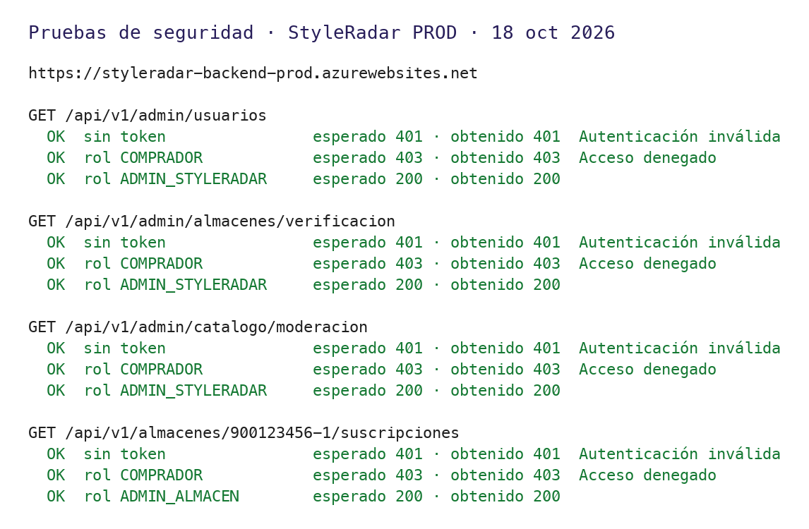

## Cómo levantar el proyecto localmente

Prerrequisitos: Java 21, Maven y Docker Desktop.

```shell
git clone https://github.com/CatrachoINXS/StyleRadar-Backend.git
cd StyleRadar-Backend/style-radar
cp .env.example .env
docker compose up --build -d
```

El archivo `docker-compose.yml` levanta la API y PostgreSQL en una red compartida, con un volumen persistente para los datos. La API queda disponible en `http://localhost:8080/swagger-ui/index.html`.

Contenedores en ejecución:


Swagger desde el contenedor:

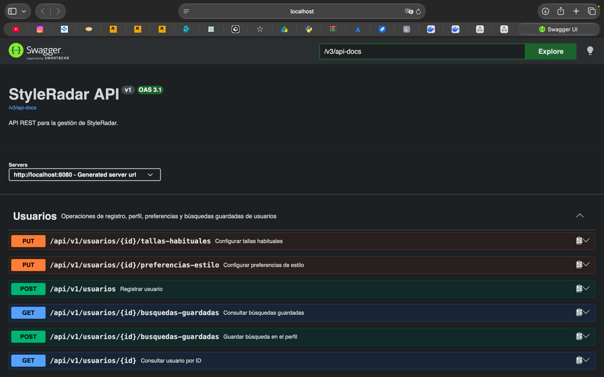

Registro de inicio de la API con conexión a la base de datos:


La imagen del backend está publicada en Docker Hub: [juanamunoz/styleradar](https://hub.docker.com/r/juanamunoz/styleradar).

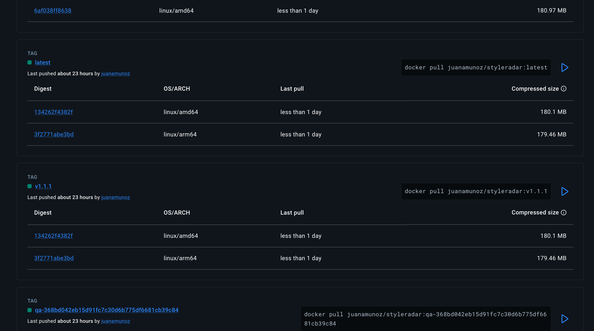

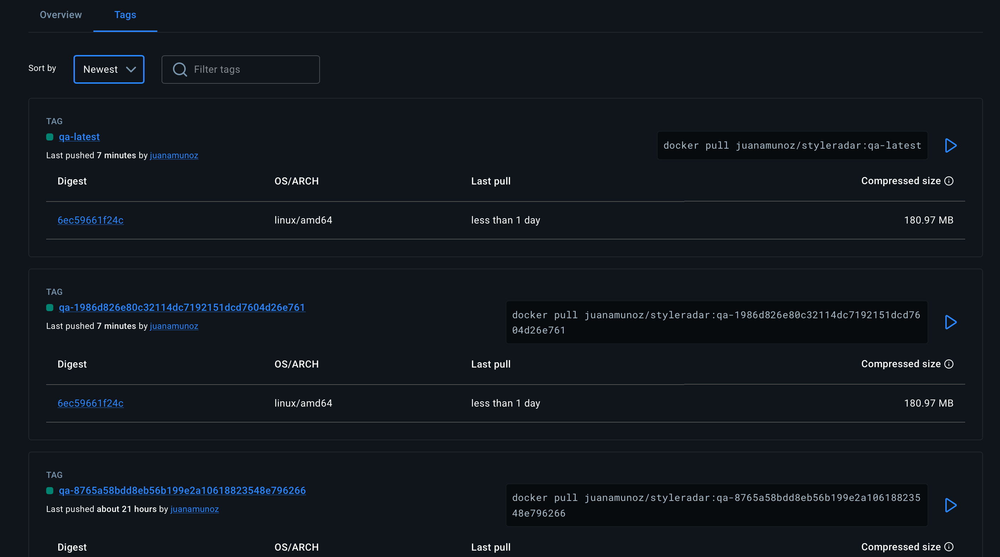

## Variables de entorno

Los valores de ejemplo están en `style-radar/.env.example`. El archivo `.env` con los valores reales no se versiona.

| Variable | Descripción | Ejemplo |
|---|---|---|
| `DB_URL` | URL JDBC de PostgreSQL. En Docker Compose se construye a partir de `DB_NAME`. | `jdbc:postgresql://localhost:5432/styleradar` |
| `DB_NAME` | Nombre de la base de datos creada por el contenedor de PostgreSQL. | `styleradar` |
| `DB_USERNAME` | Usuario de la base de datos. | `styleradar` |
| `DB_PASSWORD` | Contraseña de la base de datos. | `change-me` |
| `DB_PORT` | Puerto expuesto de PostgreSQL en la máquina local. | `5432` |
| `API_PORT` | Puerto expuesto de la API en la máquina local. | `8080` |
| `SERVER_PORT` | Puerto interno de la aplicación. | `8080` |
| `JPA_DDL_AUTO` | Estrategia de Hibernate para el esquema. | `update` |
| `JWT_SECRET_BASE64` | Clave para firmar los tokens de acceso, codificada en Base64 y de al menos 256 bits. Se puede generar con `openssl rand -base64 32`. | `change-me-base64-key` |
| `JWT_DURATION` | Tiempo de validez de los tokens de acceso. | `PT60M` |
| `CORS_ALLOWED_ORIGINS` | Orígenes del frontend permitidos, separados por coma. | `http://localhost:3000` |
| `STYLERADAR_DEMO_ENABLED` | Carga al iniciar los datos de demostración: 3 almacenes, 10 prendas, 3 planes, una fundación y un usuario por rol. No duplica datos al reiniciar. | `false` |
| `STYLERADAR_DEMO_PASSWORD` | Contraseña de los usuarios de demostración. Sin valor no se crean. | `change-me` |
| `PROBADOR_IA_API_KEY` | Clave de la API de FASHN para el probador virtual. Sin valor se usa la composición local. | `change-me` |
| `PROBADOR_IA_URL` | URL base de la API de FASHN. | `https://api.fashn.ai/v1` |
| `DOCKER_IMAGE` | Nombre de la imagen en Docker Hub. | `usuario/styleradar` |
| `IMAGE_TAG` | Tag de la imagen construida. | `latest` |

## Diagrama de Contexto
En el siguiente diagrama de contexto se presenta la arquitectura general y los actores que interactúan con StyleRadar.

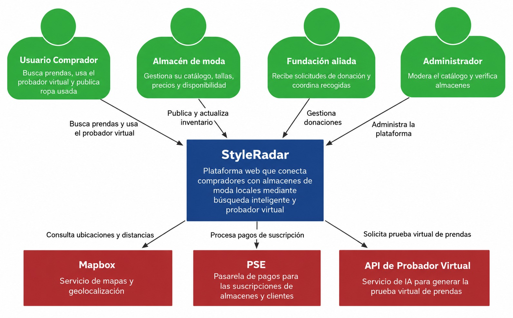

### Actores
Como actores tenemos a los *usuarios compradores, a los almacenes de moda, a las fundaciones aliadas y al administrador*.

Cada uno de los susodichos interactúa de manera diferente en la plataforma, tal y como se menciona en el diagrama.

### Sistemas externos
Como sistemas externos están *Mapbox* para que los usuarios compradores puedan saber a donde tienen que ir para comprar su prenda. *PSE* como pasarela de pagos para las suscripciones, contemplada en el diseño pero aún no integrada (ver [Limitaciones conocidas](#limitaciones-conocidas)), y *FASHN* como servicio de prueba virtual, que genera una imagen del usuario comprador con determinada prenda.

## Diagrama de clases


#### Estructura general del diagrama de clases
En color azul se encuentra lo relacionado con los usuarios y los almacenes. La clase `Usuario` guarda sus roles, el estado de la cuenta, las preferencias de estilo y las tallas habituales, y se relaciona con sus búsquedas guardadas. La clase `Almacen` contiene la información de contacto, la ubicación, la reputación y las categorías de cada tienda.

En color amarillo se agrupa lo referente a las prendas. `Prenda` describe la prenda; `ItemCatalogo` representa su publicación en el catálogo de un almacén, con su inventario por talla (`InventarioTalla`) y sus imágenes (`ImagenCatalogo`). También se encuentran las publicaciones de segunda mano (`PublicacionSegundaMano`).

En color verde se encuentran las Playlists de estilo, que agrupan varias prendas y registran los usuarios que les dan me gusta. En color morado están las alertas que crea un usuario y las notificaciones que estas generan, y en color naranja las suscripciones de los almacenes y sus planes.

En color rojo se encuentran las donaciones: la `Fundacion`, administrada por un usuario representante, y la `SolicitudDonacion`, con la que un usuario dona una prenda publicada en segunda mano. En color gris están el chat entre comprador y vendedor (`Conversacion` y `Mensaje`) y la foto del probador virtual (`FotoProbador`).

#### Relaciones
Cada enumeración está conectada con las clases que la usan como tipo de uno de sus atributos, indicando su multiplicidad. Las enumeraciones de verificación de almacenes y de moderación del catálogo se relacionan con una dependencia `«use»`, ya que se usan en esos procesos pero no son atributos de `Almacen` ni de `ItemCatalogo`.

## Diagrama de componentes específico


#### Módulos
Cada módulo se encarga de una parte específica de la plataforma:
- **Autenticación:** inicio de sesión y manejo de credenciales.
- **Usuarios:** registro, perfil, preferencias, búsquedas guardadas y gestión del estado de las cuentas.
- **Almacenes:** información de los almacenes, verificación, administradores asociados y búsqueda por distancia.
- **Catálogo:** publicación de prendas, inventario por talla, imágenes y moderación del catálogo.
- **Búsqueda y personalización:** búsqueda con filtros, prendas similares y recomendaciones personalizadas.
- **Segunda mano:** publicación, búsqueda, edición y venta de prendas usadas entre usuarios.
- **Playlists:** creación de playlists de estilo, gestión de sus prendas e interacción de otros usuarios.
- **Alertas:** alertas de disponibilidad y notificaciones para los usuarios.
- **Suscripciones:** planes y suscripciones de los almacenes.
- **Donaciones:** solicitudes de donación de prendas de segunda mano, su decisión, recogida y recepción.
- **Fundaciones:** registro, edición, desactivación y consulta de las fundaciones aliadas cercanas.
- **Chat:** conversaciones y mensajes entre el comprador y el vendedor de una prenda de segunda mano.
- **Probador virtual:** foto del comprador y generación de la prueba. El servicio depende de la interfaz `ProbadorIA`, implementada por el adaptador `FashnProbadorIA`, que se comunica con FASHN. Si el servicio externo no responde, se usa la composición local de `ComposicionProbador`.

Además, existen componentes transversales para la seguridad (`SecurityConfig`, `JwtAuthFilter`, `JwtUtil`), el manejo uniforme de errores (`GlobalExceptionHandler`), la documentación de la API (`SwaggerConfig`) y el manejo del tiempo (`TimeConfig`).

#### Estructura de los módulos
En cada módulo, el `Controller` recibe la solicitud y usa un `Mapper` para convertir los datos recibidos en objetos del dominio. El Controller depende de la interfaz del servicio (por ejemplo `IUsuarioService`), que es implementada por el `Service`. El Service aplica la lógica de negocio apoyándose en los `Validator` y calculadores, usa el `EntityMapper` para convertir los objetos del dominio en entidades y se comunica con el `Repository`, que accede a la base de datos.

## Diagrama de componentes general


Los actores (usuario comprador, almacén, fundación aliada y administrador) usan el ***Front-End***, una aplicación web que consume la API REST del ***Back-End*** en la ruta `/api/v1`. El Back-End, construido con Spring Boot, agrupa trece módulos funcionales con el mismo código de colores del diagrama de base de datos. Contiene la lógica de negocio y la seguridad con JWT y roles, y almacena la información en la ***Base de Datos*** PostgreSQL por medio de JDBC.

Sobre los sistemas externos:

- **Mapbox:** lo usa el Front-End para mostrar el mapa.
- **FASHN:** lo usa el Back-End para generar la imagen del probador virtual.
- **PSE:** se muestra con línea punteada porque está contemplado en el diseño, pero no está integrado. Las suscripciones se registran sin cobro.

## Diagrama de base de datos


#### Estructura de la base de datos
En color azul se encuentran los usuarios y los almacenes. La tabla `usuarios` se relaciona con sus roles, sus credenciales, sus preferencias de estilo, sus tallas habituales y sus búsquedas guardadas. La tabla `almacenes` se identifica por el NIT y se relaciona con sus categorías y con los usuarios que la administran.

En color amarillo se agrupa todo lo relacionado con las prendas. Cada prenda que un almacén publica se registra en `items_catalogo`, que a su vez guarda el inventario por talla, las imágenes y el control de disponibilidad. Las publicaciones de ropa de segunda mano se registran en `publicaciones_segunda_mano`, junto con sus fotos.

En color verde se encuentran las playlists de estilo, con las prendas que contienen y los usuarios que les dan me gusta o las guardan. En color morado están las alertas y las notificaciones de cada usuario, y en color naranja los planes y las suscripciones de los almacenes.

En color rojo están las fundaciones aliadas, los tipos de prenda que reciben y las solicitudes de donación, que relacionan al donante, la fundación y la publicación de segunda mano. En color gris están las conversaciones y los mensajes del chat entre comprador y vendedor, y la foto del probador virtual de cada usuario.

El diagrama se obtuvo del esquema real de PostgreSQL y tiene 30 tablas. La descripción de cada tabla está en el [documento de arquitectura](style-radar/docs/arquitectura/diagramas-despliegue-seguridad.md#tablas-utilizadas).

La justificación de la base de datos elegida se encuentra en la sección [Decisión de persistencia](#decisión-de-persistencia).

## Diagrama de despliegue


#### Descripción del despliegue
- **Equipo del desarrollador:** desde aquí se suben los cambios al repositorio de GitHub.
- **GitHub:** contiene el repositorio y el entorno de ejecución de GitHub Actions, donde se ejecutan los pipelines `ci-qa.yml` y `ci-prod.yml`. Ambos compilan y prueban el proyecto, generan el artefacto `styleradar.jar` y construyen la imagen Docker.
- **Docker Hub:** almacena la imagen `juanamunoz/styleradar` con sus tags de QA y de versión.
- **Microsoft Azure:** cada ambiente (QA y producción) tiene su propio App Service, que ejecuta el contenedor Docker con el artefacto `app.jar` y las variables de entorno definidas en sus App Settings, y su propia base de datos PostgreSQL. La comunicación entre la aplicación y la base de datos se realiza por JDBC con conexión cifrada.
- **Equipo del usuario:** accede a la API desde el navegador por HTTPS.

El despliegue en producción requiere además una aprobación manual en GitHub.

## Diagramas de secuencia

Los diagramas de secuencia muestran, para cada funcionalidad principal, el recorrido de la petición por el filtro JWT, el Controller, la validación, el Service, el Repository y la base de datos. También muestran las rutas de error. La explicación de cada uno está en [`diagramas-secuencia.md`](style-radar/docs/arquitectura/diagramas-secuencia.md).

**Inicio de sesión (RF-02):**

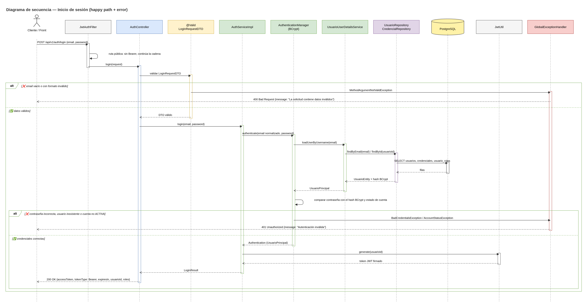

**Publicar una prenda en el catálogo (RF-50):**

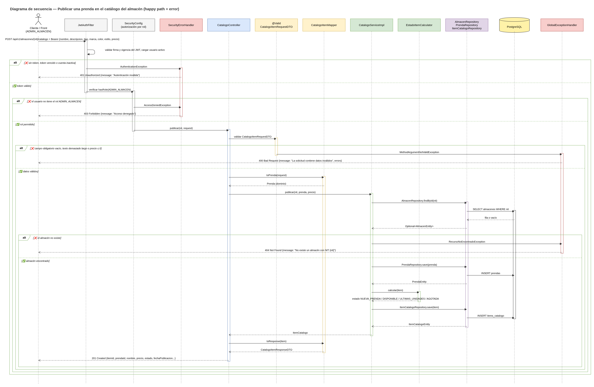

**Búsqueda de prendas con filtros (RF-07 a RF-16):**

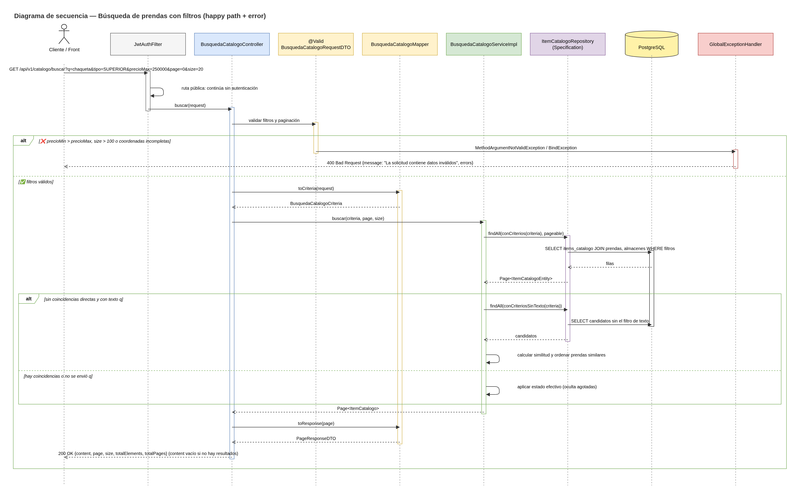

**Suscripción de un almacén a un plan (RF-67):**

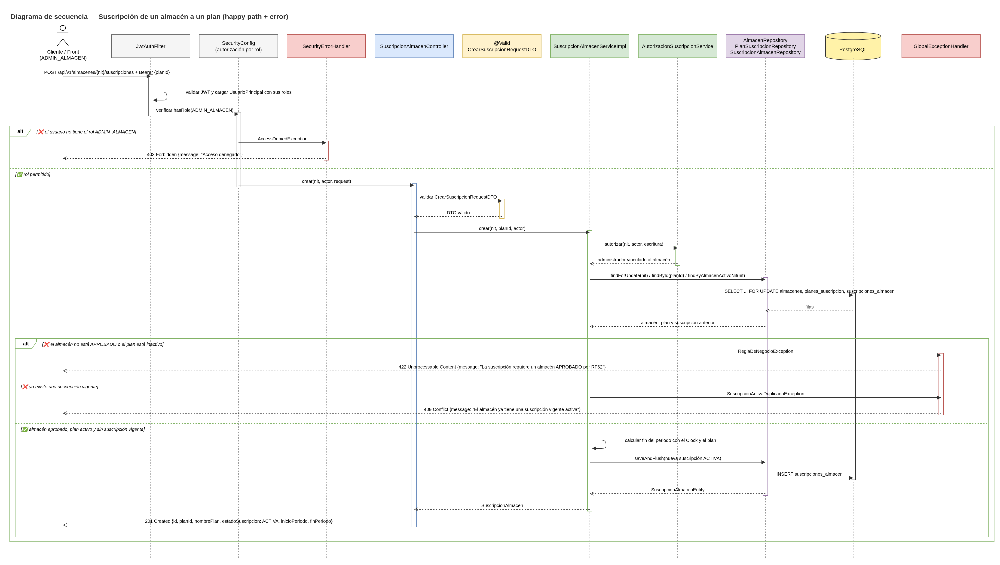

## Documento de arquitectura

El documento de arquitectura completo está en PDF: [`StyleRadar-Documento-Backend.pdf`](style-radar/docs/arquitectura/StyleRadar-Documento-Backend.pdf). Sus secciones también están en [`style-radar/docs/arquitectura`](style-radar/docs/arquitectura):

| Sección | Contenido |
|---|---|
| [Diagramas, despliegue y seguridad](style-radar/docs/arquitectura/diagramas-despliegue-seguridad.md) | ERD y tablas, diagrama de clases, componentes general y específico, despliegue, roles y permisos, URLs de PROD |
| [Funcionalidades expuestas — parte A](style-radar/docs/arquitectura/funcionalidades-expuestas-parte-a.md) | Endpoints de identidad, perfil, búsqueda, geolocalización, catálogo, administración y suscripciones, con sus campos y ejemplos |
| [Diagramas de secuencia](style-radar/docs/arquitectura/diagramas-secuencia.md) | Inicio de sesión, publicación de prenda, búsqueda con filtros y suscripción de almacén |

## Swagger/OpenAPI

La documentación de todos los endpoints está disponible en Swagger UI y en el documento OpenAPI:

- PROD: https://styleradar-backend-prod.azurewebsites.net/swagger-ui/index.html y `/v3/api-docs`
- Local: `http://localhost:8080/swagger-ui/index.html`

## Roles y permisos

El sistema maneja cuatro roles: `COMPRADOR`, `ADMIN_ALMACEN`, `REPRESENTANTE_FUNDACION` y `ADMIN_STYLERADAR`. Los permisos se definen en `SecurityConfig`:

| Endpoints | Métodos | Acceso |
|---|---|---|
| `/api/v1/auth/login`, `/api/v1/auth/registro`, `/api/v1/usuarios` | POST | Público |
| `/api/v1/prendas`, `/api/v1/catalogo/buscar`, `/api/v1/almacenes`, `/api/v1/almacenes/{nit}/catalogo`, `/api/v1/almacenes/{nit}/catalogo/resumen`, `/api/v1/almacenes/{nit}/catalogo/novedades`, `/api/v1/almacenes/{nit}/distancia`, `/api/v1/planes-suscripcion` | GET | Público |
| `/swagger-ui/**`, `/v3/api-docs/**` | GET | Público |
| `/api/v1/almacenes/{nit}/suscripciones`, `/api/v1/almacenes/{nit}/suscripciones/vigente`, `/api/v1/almacenes/{nit}/suscripciones/{id}/renovacion` | GET, POST, PATCH | `ADMIN_ALMACEN` |
| `/api/v1/admin/usuarios`, `/api/v1/admin/usuarios/{id}`, `/api/v1/admin/usuarios/{id}/estado` | GET, PATCH | `ADMIN_STYLERADAR` |
| `/api/v1/admin/almacenes/verificacion`, `/api/v1/admin/almacenes/{nit}/verificacion`, `/api/v1/admin/almacenes/{nit}/verificacion/solicitar-revision` | GET, PATCH, POST | `ADMIN_STYLERADAR` |
| `/api/v1/admin/almacenes/{nit}/administradores/{usuarioId}` | PUT | `ADMIN_STYLERADAR` |
| `/api/v1/admin/catalogo/moderacion`, `/api/v1/admin/catalogo/{itemId}/moderacion`, `/api/v1/admin/catalogo/{itemId}/moderacion/solicitar-revision` | GET, PATCH, POST | `ADMIN_STYLERADAR` |
| `/api/v1/admin/fundaciones/**` (registrar, editar, desactivar) | POST, PUT, PATCH, GET | `ADMIN_STYLERADAR` |
| `/api/v1/usuarios/me`, `/me/preferencias-estilo`, `/me/tallas-habituales`, `/me/busquedas-guardadas/**` | GET, PUT, POST, DELETE | `COMPRADOR` |
| `/api/v1/usuarios/{id}` | GET | `ADMIN_STYLERADAR` |
| `POST /api/v1/segunda-mano`, `/api/v1/usuarios/me/segunda-mano/**` (editar, vender, donar, retirar) | POST, PUT, PATCH, DELETE | `COMPRADOR` (propietario) |
| `POST /api/v1/playlists`, `/api/v1/usuarios/me/playlists/**`, `/api/v1/playlists/{id}/like`, `/guardar`, `/api/v1/usuarios/me/playlists-guardadas` | GET, POST, PUT, DELETE | `COMPRADOR` |
| `GET /api/v1/segunda-mano`, `GET /api/v1/segunda-mano/{id}`, `GET /api/v1/playlists`, `/api/v1/playlists/{id}`, `/api/v1/playlists/populares` | GET | Cualquier usuario autenticado |
| `/api/v1/segunda-mano/{id}/conversaciones`, `/api/v1/conversaciones/**`, `/api/v1/usuarios/me/conversaciones` | GET, POST | `COMPRADOR` (solo participantes del chat) |
| `/api/v1/usuarios/me/probador/**` | GET, POST, DELETE | `COMPRADOR` |
| `GET /api/v1/fundaciones` (cercanas), `/api/v1/usuarios/me/donaciones` | GET, POST | `COMPRADOR` |
| `/api/v1/fundaciones/mi-fundacion/solicitudes/**` (consultar, decidir, recepción) | GET, PATCH | `REPRESENTANTE_FUNDACION` |
| `PATCH /api/v1/donaciones/{id}/recogida` | PATCH | `COMPRADOR` (donante) o `REPRESENTANTE_FUNDACION` (solo participantes) |
| `POST`, `PUT`, `PATCH` y `DELETE` en `/api/v1/almacenes/{nit}/catalogo/**` (publicar, editar, retirar, tallas, inventario e imágenes) | POST, PUT, PATCH, DELETE | `ADMIN_ALMACEN` |
| `/api/v1/usuarios/me/alertas/**`, `/api/v1/usuarios/me/notificaciones`, `/api/v1/usuarios/me/feed`, `/api/v1/usuarios/me/recomendaciones` | GET, POST, PATCH | `COMPRADOR` |

Las peticiones sin token reciben `401` y las que no tienen el rol requerido reciben `403`. Cada endpoint de usuarios, segunda mano, playlists, fundaciones, donaciones, probador y chat declara `@PreAuthorize` en su interfaz `controller/docs/*Api`; en las rutas `/me` el usuario sale siempre del JWT, nunca de la URL. CORS solo admite los orígenes de `CORS_ALLOWED_ORIGINS`. Al registrar una fundación, su representante recibe el rol `REPRESENTANTE_FUNDACION`.

## Patrones de diseño

| Patrón | Problema que resuelve | Clase concreta | Diagrama |
|---|---|---|---|
| Repository | Separa el acceso a la base de datos de la lógica de negocio. | `ItemCatalogoRepository`, `UsuarioRepository` | Componentes específico |
| Specification | Permite combinar filtros de búsqueda opcionales (tipo, color, talla, precio, marca, estilo) sin escribir una consulta para cada combinación. | `ItemCatalogoSpecifications`, `PublicacionSegundaManoSpecifications` | Componentes específico (Búsqueda y Segunda mano) |
| Data Mapper | Convierte los datos entre DTO, objetos del dominio y entidades sin mezclar esa lógica en los servicios. | `CatalogoItemMapper`, `ItemCatalogoEntityMapper` | Componentes específico |
| Chain of Responsibility | Procesa la autenticación de cada petición mediante una cadena de filtros de seguridad. | `JwtAuthFilter` dentro de la cadena configurada en `SecurityConfig` | Componentes específico (Seguridad) |
| Inyección de dependencias | Los controladores dependen de interfaces y no de implementaciones concretas, lo que facilita las pruebas y el cambio de implementación. | `ICatalogoService` implementada por `CatalogoServiceImpl` | Componentes específico (interfaces entre Controller y Service) |
| Builder | Facilita la creación de objetos con muchos atributos opcionales. | `UsuarioEntity`, `PlaylistEntity` | Base de datos |

### Diseño propuesto

Las siguientes ilustraciones conservan las propuestas de diseño del producto. Su presencia no implica que exista una implementación en el alcance actual del backend.

#### Strategy — diseño propuesto, no implementado

La propuesta plantea algoritmos intercambiables para sugerencias del feed. El módulo actual no implementa un feed, una interfaz Strategy ni estrategias concretas.

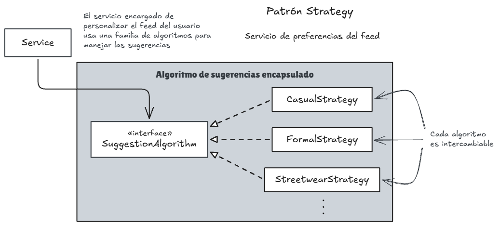

#### Observer — diseño propuesto, no implementado

La propuesta contempla notificaciones a compradores cuando se publica una prenda. En el código actual no existen el sujeto, los observadores ni las clases `PublicaciónPrenda` y `UsuarioComprador` descritas originalmente.

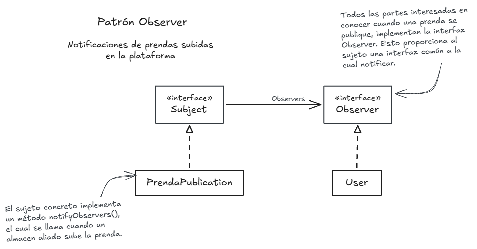

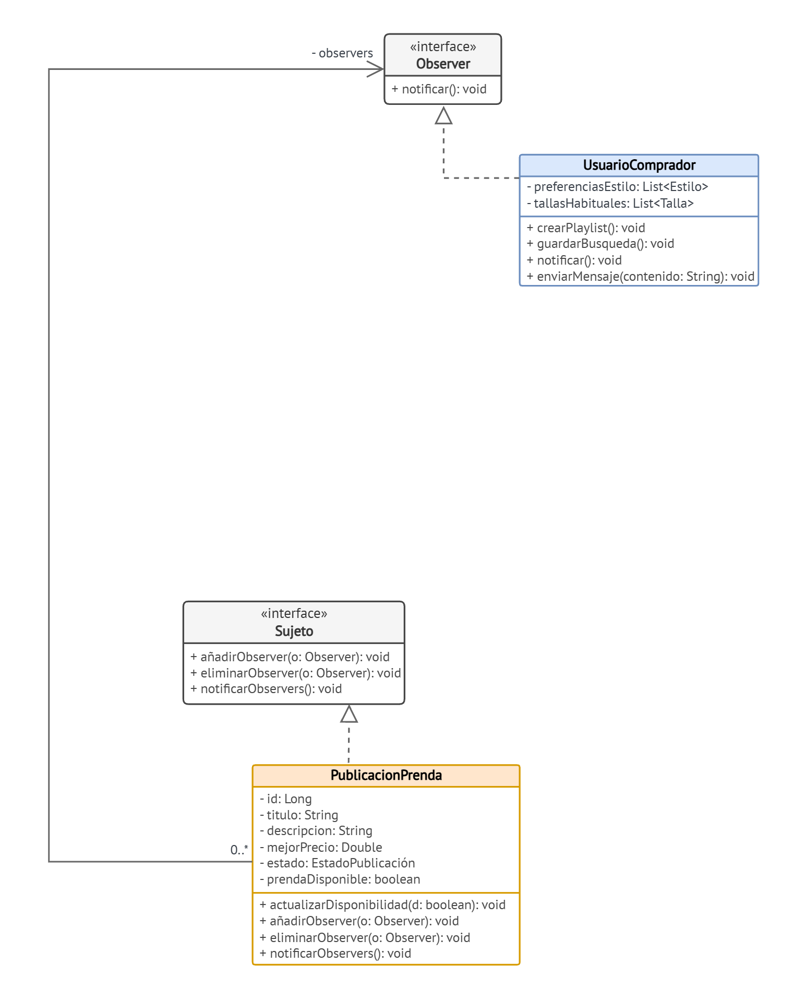

#### Adapter — implementado en el probador virtual

El probador virtual depende de la interfaz `ProbadorIA`, y `FashnProbadorIA` la adapta a la API de FASHN: envía la foto del usuario, la foto de la prenda y su categoría, y devuelve la imagen generada. `ProbadorVirtualServiceImpl` no conoce los detalles del proveedor, por eso el cambio de proveedor solo requirió reemplazar el adaptador. Si FASHN no está configurado, falla o tarda más de 30 segundos, se genera la composición local con `ComposicionProbador`. La adaptación de pasarelas de pago sigue como diseño propuesto.

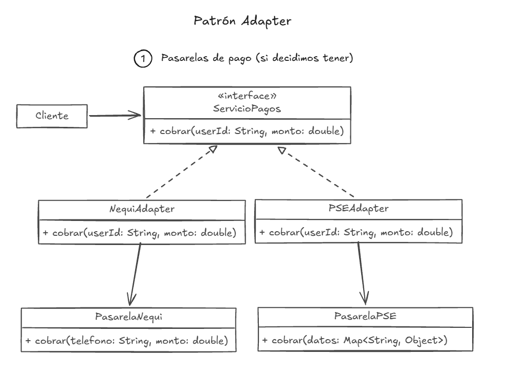

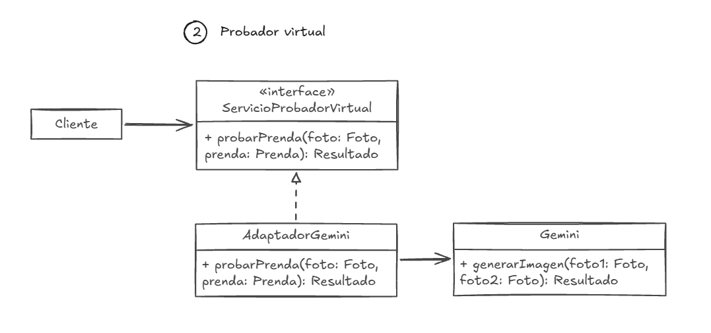

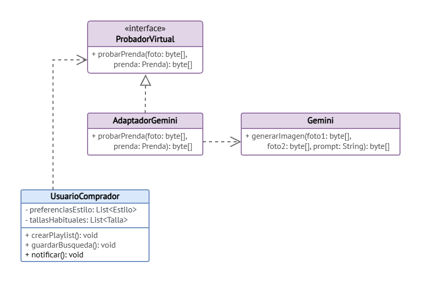

#### Composite — composición del framework, no patrón propio implementado

La búsqueda combina filtros con `Specification<ItemCatalogoEntity>` de Spring Data JPA en `ItemCatalogoSpecifications`. Esa composición permite unir predicados con AND y OR, pero el proyecto no define una jerarquía Composite propia como `FiltroTalla`, `FiltroColor` o `FiltroCompuestoAnd`. La ilustración se conserva como diseño conceptual.

El patrón composite nos resuelve el problema de la combinacion de filtros en las búsquedas inteligentes. Con este patrón podemos crear filtros simples como `FiltroTalla` o `FiltroColor`, y filtros complejos como `FiltroCompuestoAnd` (que combina dos filtros) y tratarlos de la misma forma. De esta forma, evaluar si una prenda cumple con un filtro de búsqueda complejo, se vuelve más sencillo. 

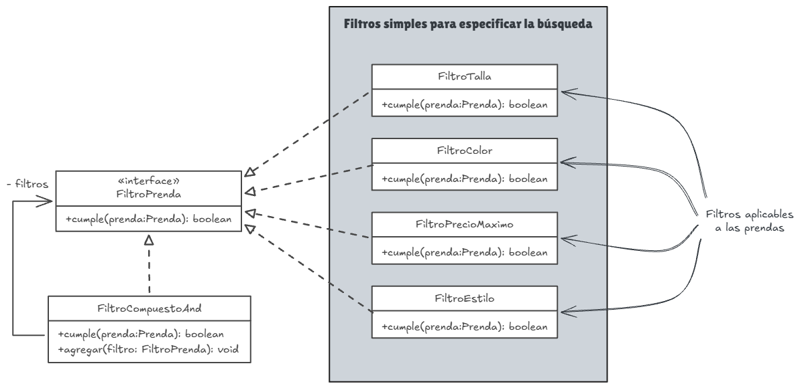

#### Iterator — diseño propuesto, no implementado

El código utiliza colecciones, streams y mecanismos de iteración provistos por Java y Spring Data. No existe un iterador personalizado del dominio; la ilustración representa una posibilidad de diseño, no el estado del código.

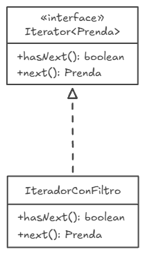

## Decisión de persistencia

Se eligió PostgreSQL, una base de datos relacional, porque la información de StyleRadar está muy conectada entre sí: un almacén tiene muchas prendas publicadas, cada prenda tiene inventario por talla e imágenes, y los usuarios crean playlists y publicaciones que hacen referencia a esas mismas prendas. Un modelo relacional permite representar estas relaciones de forma directa y consultar la información combinada, por ejemplo al buscar prendas con filtros por talla, precio o almacén.

Además, la base de datos ayuda a mantener la información consistente por medio de reglas propias:

- El correo de cada usuario es único.
- Una misma prenda del catálogo no puede tener dos registros de inventario para la misma talla.
- Las unidades disponibles nunca pueden ser negativas.
- Las publicaciones, los inventarios y las imágenes siempre deben estar asociados a un registro existente.
- Un almacén solo puede tener una suscripción activa a la vez.
- Un usuario no puede tener dos alertas activas sobre el mismo objetivo.

El acceso a los datos se realiza con Spring Data JPA, lo que permite trabajar con las tablas a partir de las clases del proyecto y mantener separada la lógica de negocio del manejo de la base de datos.

## CI/CD

El repositorio cuenta con dos pipelines en GitHub Actions.

**QA** (`.github/workflows/ci-qa.yml`). Cada vez que se integran cambios en las ramas `develop` o `main` se ejecutan los siguientes pasos:

1. **Pruebas y cobertura:** se ejecutan todas las pruebas y se verifica que la cobertura sea de al menos 85 %.
2. **Imagen QA:** se construye la imagen del backend y se publica en Docker Hub con los tags `qa-latest` y `qa-<commit>`.
3. **Despliegue en QA:** la nueva imagen se despliega en el App Service de QA en Azure y se comprueba que la documentación de la API responda correctamente.

Las pruebas también se ejecutan en cada pull request hacia `main` o `develop`, sin publicar ni desplegar.

**PROD** (`.github/workflows/ci-prod.yml`). Se ejecuta al publicar un tag de versión con el formato `v*.*.*`, por ejemplo `v1.0.0`:

1. **Pruebas y cobertura:** se repite la validación de las pruebas y de la cobertura mínima.
2. **Imagen de la versión:** se publica la imagen en Docker Hub con el número de versión y con el tag `latest`.
3. **Aprobación manual:** el despliegue queda en espera hasta que un revisor autorizado lo apruebe en el ambiente `production` de GitHub.
4. **Despliegue en PROD:** la imagen aprobada se despliega en el App Service de producción y se comprueba que la API responda correctamente.

El historial de ejecuciones está disponible en la pestaña [Actions](https://github.com/CatrachoINXS/StyleRadar-Backend/actions) del repositorio.

Secrets utilizados por el pipeline (los valores no se publican):

| Secret | Ámbito | Uso |
|---|---|---|
| `DOCKERHUB_USERNAME` | Repositorio | Usuario de Docker Hub. |
| `DOCKERHUB_TOKEN` | Repositorio | Token de acceso a Docker Hub. |
| `AZURE_CREDENTIALS` | Repositorio | Credenciales para desplegar en Azure. |
| `AZURE_WEBAPP_NAME_QA` | Ambiente `qa` | Nombre del App Service de QA. |
| `DB_URL_QA` | Ambiente `qa` | URL de la base de datos de QA. |
| `DB_USERNAME_QA` | Ambiente `qa` | Usuario de la base de datos de QA. |
| `DB_PASSWORD_QA` | Ambiente `qa` | Contraseña de la base de datos de QA. |
| `JWT_SECRET_QA` | Ambiente `qa` | Clave de los tokens de acceso en QA. |

En producción, la conexión a la base de datos y la clave de los tokens se configuran directamente como variables de entorno del App Service, por lo que el pipeline de PROD solo utiliza los secrets del repositorio.

### Ambientes

- **QA:** recibe automáticamente cada cambio integrado en `develop` o `main`. Se usa para validar el funcionamiento antes de publicar una versión. Tiene su propio App Service y su propia base de datos.
- **PROD:** recibe únicamente las versiones publicadas con un tag `v*.*.*` y aprobadas manualmente. Tiene su propio App Service y su propia base de datos, separados de QA.

## Evidencias

Todas las capturas están en [`style-radar/docs/evidencias`](style-radar/docs/evidencias):

| Evidencia | Archivo |
|---|---|
| `mvn verify` con número de pruebas y cobertura | [`pruebas-mvn-verify.png`](style-radar/docs/evidencias/pruebas-mvn-verify.png), [`cobertura-jacoco.png`](style-radar/docs/evidencias/cobertura-jacoco.png) |
| Pipelines de QA y PROD en verde | [`pipeline-qa.png`](style-radar/docs/evidencias/pipeline-qa.png), [`pipeline-prod.png`](style-radar/docs/evidencias/pipeline-prod.png), [`aprobacion-prod.jpg`](style-radar/docs/evidencias/aprobacion-prod.jpg) |
| Swagger en la URL de PROD | [`swagger-prod.png`](style-radar/docs/evidencias/swagger-prod.png) |
| Imagen publicada en Docker Hub | [`docker-hub.png`](style-radar/docs/evidencias/docker-hub.png), [`docker-hub-qa.png`](style-radar/docs/evidencias/docker-hub-qa.png) |
| Set de pruebas de funcionamiento contra PROD | [`postman-prod.png`](style-radar/docs/evidencias/postman-prod.png) |
| Pruebas de seguridad (401, 403 y 200) | [`seguridad-prod.png`](style-radar/docs/evidencias/seguridad-prod.png) |
| Docker local y App Services en Azure | [`docker-compose-ps.png`](style-radar/docs/evidencias/docker-compose-ps.png), [`docker-logs-api.png`](style-radar/docs/evidencias/docker-logs-api.png), [`azure-app-service-qa.png`](style-radar/docs/evidencias/azure-app-service-qa.png), [`azure-app-service-prod.png`](style-radar/docs/evidencias/azure-app-service-prod.png) |

Pipeline de QA en verde:

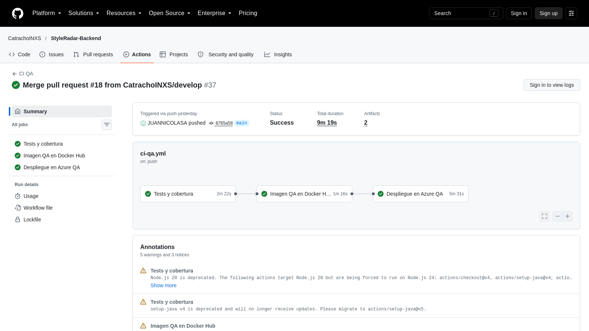

Pipeline de PROD en verde:

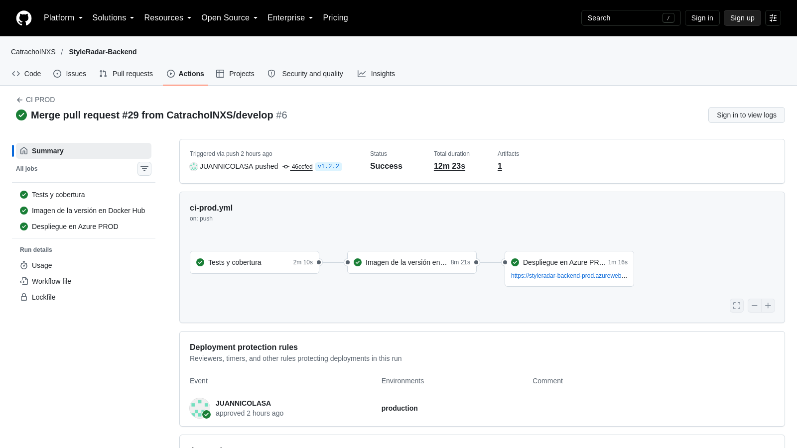

Despliegue a producción aprobado manualmente:

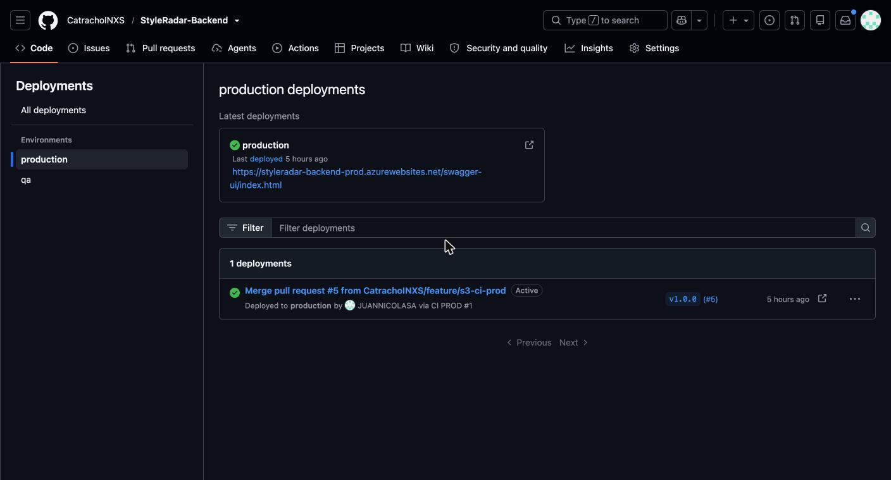

App Service de QA y PROD en Azure con el contenedor en ejecución:


Swagger en Azure:


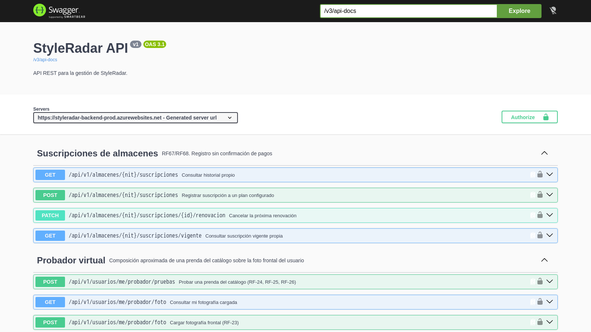

## Trazabilidad funcional

| RF | Funcionalidad | Endpoint |
|---|---|---|
| RF-01 | Registrar usuario | `POST /api/v1/auth/registro`, `POST /api/v1/usuarios` |
| RF-02 | Iniciar sesión | `POST /api/v1/auth/login` |
| RF-03, RF-04 | Preferencias de estilo y tallas habituales | `PUT /api/v1/usuarios/me/preferencias-estilo`, `PUT /api/v1/usuarios/me/tallas-habituales` |
| RF-05, RF-06 | Feed personalizado y recomendaciones | `GET /api/v1/usuarios/me/feed`, `GET /api/v1/usuarios/me/recomendaciones` |
| RF-07 a RF-16 | Búsqueda por texto, filtros, orden por distancia o reputación y prendas similares | `GET /api/v1/catalogo/buscar` |
| RF-17, RF-18 | Almacenes en el mapa y filtro por categoría | `GET /api/v1/almacenes` |
| RF-19, RF-20 | Catálogo resumido y novedades semanales | `GET /api/v1/almacenes/{nit}/catalogo/resumen`, `GET /api/v1/almacenes/{nit}/catalogo/novedades` |
| RF-21 | Distancia entre usuario y almacén | `GET /api/v1/almacenes/{nit}/distancia` |
| RF-22 | Catálogo de un almacén | `GET /api/v1/almacenes/{nit}/catalogo` |
| RF-23 a RF-27 | Probador virtual: foto, prueba con FASHN o composición local, eliminación | `/api/v1/usuarios/me/probador/foto`, `POST /api/v1/usuarios/me/probador/pruebas` |
| RF-28 | Búsquedas guardadas | `/api/v1/usuarios/me/busquedas-guardadas` |
| RF-29 a RF-32 | Alertas de disponibilidad, detección, notificaciones y desactivación | `/api/v1/usuarios/me/alertas`, `GET /api/v1/usuarios/me/notificaciones` |
| RF-33 a RF-35 | Publicar prenda de segunda mano con estado de conservación y precio | `POST /api/v1/segunda-mano` |
| RF-36 | Buscar prendas de otros usuarios | `GET /api/v1/segunda-mano` |
| RF-37 a RF-39 | Editar, marcar como vendida y retirar una publicación | `/api/v1/usuarios/me/segunda-mano/{id}` |
| RF-40, RF-41 | Chat con el vendedor y coordinación de entrega | `POST /api/v1/segunda-mano/{id}/conversaciones`, `/api/v1/conversaciones/{id}/mensajes` |
| RF-42 a RF-49 | Donaciones: marcar prenda, fundaciones cercanas, solicitud, decisión, recogida y recepción | `PATCH /api/v1/usuarios/me/segunda-mano/{id}/donacion`, `/api/v1/usuarios/me/donaciones`, `GET /api/v1/fundaciones`, `/api/v1/fundaciones/mi-fundacion/solicitudes`, `PATCH /api/v1/donaciones/{id}/recogida` |
| RF-50 a RF-55, RF-58 | Publicar, editar y retirar prendas del catálogo con fotos, tallas, precio y atributos | `/api/v1/almacenes/{nit}/catalogo`, `/api/v1/almacenes/{nit}/catalogo/{itemId}/imagenes`, `/tallas` |
| RF-56, RF-57, RF-59, RF-60 | Disponibilidad por talla y estados AGOTADA, ULTIMAS_UNIDADES y NUEVA_PRENDA | `PATCH /api/v1/almacenes/{nit}/catalogo/{itemId}/inventario/{talla}` |
| RF-61 | Moderación de publicaciones | `/api/v1/admin/catalogo/moderacion` |
| RF-62 | Verificación de almacenes | `/api/v1/admin/almacenes/verificacion` |
| RF-63 a RF-65 | Registrar, editar y desactivar fundaciones | `/api/v1/admin/fundaciones` |
| RF-66 | Cambiar estado de usuario | `PATCH /api/v1/admin/usuarios/{id}/estado` |
| RF-67, RF-68 | Suscripción de almacenes y cancelación de la renovación | `/api/v1/almacenes/{nit}/suscripciones` |
| RF-69 a RF-71 | Crear playlists, gestionar sus prendas, me gusta y guardado | `/api/v1/playlists`, `/api/v1/usuarios/me/playlists` |
| RF-72 | Playlists populares | `GET /api/v1/playlists/populares` |

## Limitaciones conocidas

| Limitación | Impacto | Cómo se resolvería |
|---|---|---|
| La gestión del catálogo exige el rol `ADMIN_ALMACEN`, pero no comprueba que el usuario administre ese almacén en particular. | Un administrador de almacén podría modificar el catálogo de otro almacén. | Verificar su vínculo con el almacén, como ya se hace en las suscripciones. |
| Las suscripciones se registran sin pago, porque PSE no está integrado. | Los planes no tienen cobro real. | Integrar la pasarela de pagos por medio de un adaptador, como en el probador virtual. |
| El chat no funciona en tiempo real. | Los mensajes nuevos se ven al consultar la conversación. | Enviar los mensajes con WebSockets. |
| Una sesión iniciada no se puede cerrar antes de que venza su token. | El token sigue siendo válido hasta su vencimiento, salvo que la cuenta se inactive o se bloquee. | Registrar los tokens revocados o usar tokens de corta duración. |

## Integrantes

| Integrante | Rol | Aporte |
|---|---|---|
| Juan Nicolás Álvarez Muñoz | Backend | Dockerización, imagen en Docker Hub, pipelines de CI/CD para QA y PROD, ambientes en Azure, diagramas (clases, componentes, base de datos, despliegue y secuencia) y documentación de despliegue. En el Sprint 4: datos de demostración, validación sobre PostgreSQL, set de pruebas de funcionamiento (parte A), probador virtual con FASHN, evidencias, documento de arquitectura y release final. |
| Daniel Valero Quiroga | Backend | Catálogo, inventario y búsqueda; autenticación con JWT; almacenes y geolocalización; personalización; alertas; moderación; verificación de almacenes; estados de cuenta; suscripciones y playlists populares. |
| Juan Diego Valderrama Gaviria | Backend | Usuarios, preferencias y búsquedas guardadas; segunda mano; playlists; configuración de PostgreSQL y JPA; manejo global de errores y configuración de Swagger. |
| Cristian Camilo Ortiz Sánchez | Diseño y documentación | Creación del repositorio, diagrama de clases inicial y diagramas de componentes iniciales. |
| Paula Alejandra Diazrama | Diseño | Diseño del producto y apoyo en la documentación del proyecto. |
