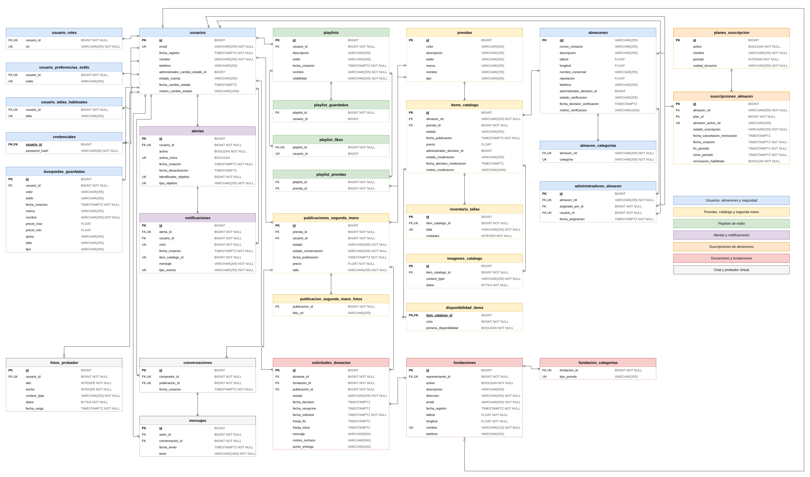
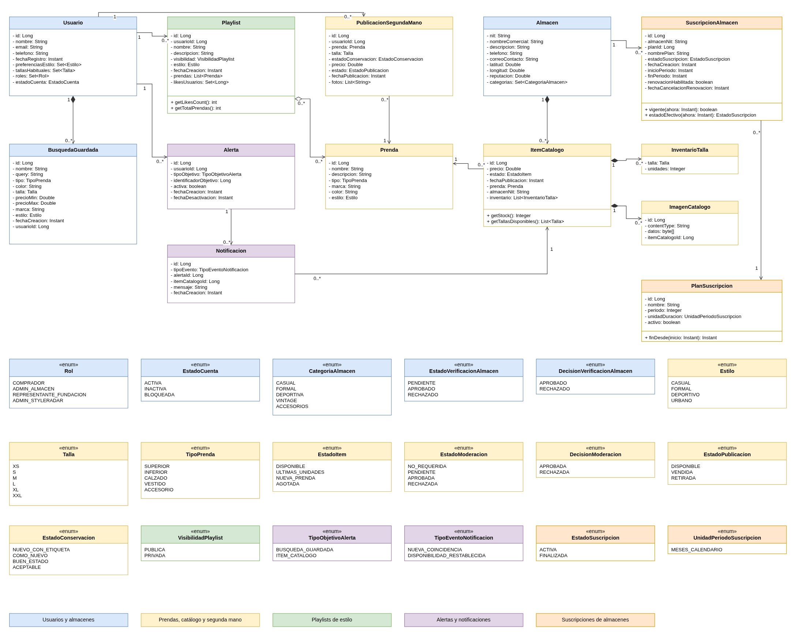
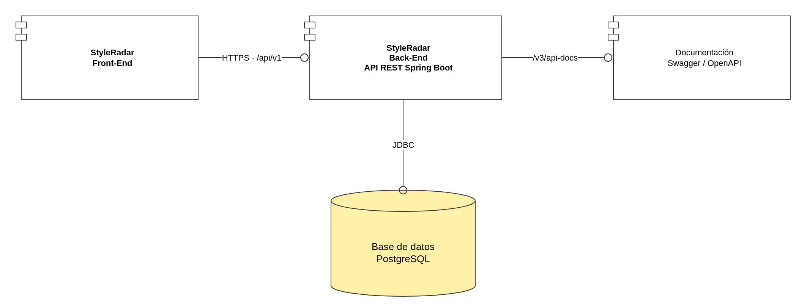
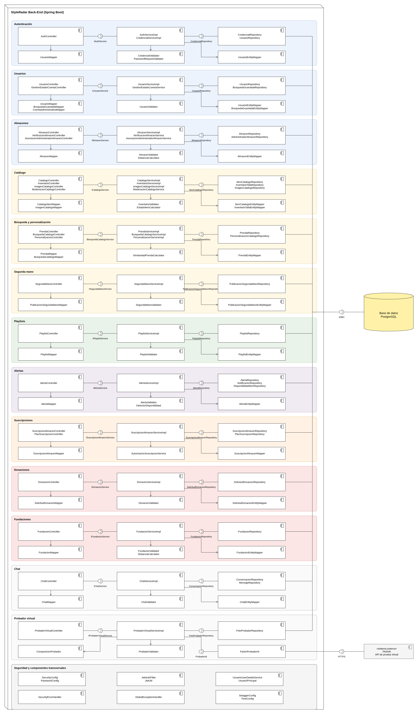
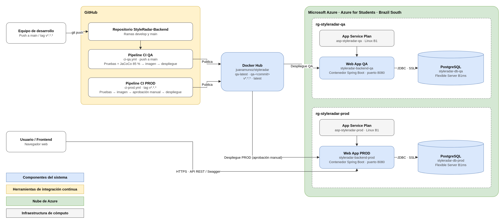

# Documento de arquitectura del backend — Diagramas, despliegue y seguridad

Esta sección describe la estructura interna de la API de StyleRadar tal como está implementada en la versión desplegada: el modelo de datos, el modelo de dominio, la organización en componentes, la infraestructura en Azure y el control de acceso por roles. Los archivos editables de cada diagrama están en [`docs/uml`](../uml) en formato draw.io.

## Índice

- [Diagrama de base de datos](#diagrama-de-base-de-datos)
- [Diagrama de clases](#diagrama-de-clases)
- [Diagrama de componentes general](#diagrama-de-componentes-general)
- [Diagrama de componentes específico](#diagrama-de-componentes-específico)
- [Diagrama de despliegue](#diagrama-de-despliegue)
- [Roles y permisos](#roles-y-permisos)
- [URLs de producción](#urls-de-producción)

## Diagrama de base de datos

El diagrama entidad-relación se construyó a partir del esquema real de PostgreSQL que genera la aplicación. Contiene 30 tablas y 37 relaciones. Cada tabla muestra sus columnas con el tipo de dato, si admite valores nulos y su papel como llave: `PK` (llave primaria), `FK` (llave foránea) y `UK` (restricción de unicidad). Las relaciones usan la notación pata de gallo: el extremo con una línea doble indica "exactamente uno" y el extremo con tres líneas indica "muchos"; cuando el extremo tiene un círculo y una línea, la relación es de cero o uno.

Los colores agrupan las tablas por módulo funcional:

| Color | Módulo | Tablas |
|---|---|---|
| Azul | Usuarios, almacenes y seguridad | `usuarios`, `usuario_roles`, `usuario_preferencias_estilo`, `usuario_tallas_habituales`, `credenciales`, `busquedas_guardadas`, `almacenes`, `almacen_categorias`, `administradores_almacen` |
| Amarillo | Prendas, catálogo y segunda mano | `prendas`, `items_catalogo`, `inventario_tallas`, `imagenes_catalogo`, `disponibilidad_items`, `publicaciones_segunda_mano`, `publicacion_segunda_mano_fotos` |
| Verde | Playlists de estilo | `playlists`, `playlist_prendas`, `playlist_likes`, `playlist_guardados` |
| Morado | Alertas y notificaciones | `alertas`, `notificaciones` |
| Naranja | Suscripciones de almacenes | `planes_suscripcion`, `suscripciones_almacen` |
| Rojo | Donaciones y fundaciones | `fundaciones`, `fundacion_categorias`, `solicitudes_donacion` |
| Gris | Chat y probador virtual | `conversaciones`, `mensajes`, `fotos_probador` |

### Tablas utilizadas

| Tabla | Para qué se usa |
|---|---|
| `usuarios` | Datos de cada persona registrada: nombre, correo único, teléfono, estado de la cuenta y auditoría del último cambio de estado. |
| `usuario_roles` | Roles asignados a cada usuario (`COMPRADOR`, `ADMIN_ALMACEN`, `REPRESENTANTE_FUNDACION`, `ADMIN_STYLERADAR`). |
| `credenciales` | Hash BCrypt de la contraseña. Relación uno a uno con `usuarios`, separada para no exponer el hash junto al perfil. |
| `usuario_preferencias_estilo`, `usuario_tallas_habituales` | Preferencias de estilo y tallas habituales del comprador, usadas por el feed y las recomendaciones. |
| `busquedas_guardadas` | Criterios de búsqueda que un comprador guarda en su perfil. |
| `almacenes` | Tiendas aliadas identificadas por NIT, con ubicación, reputación y estado de verificación. |
| `almacen_categorias` | Categorías comerciales de cada almacén, usadas en el filtro del mapa. |
| `administradores_almacen` | Asociación entre un usuario `ADMIN_ALMACEN` y el almacén que administra. |
| `prendas` | Descripción de una prenda: nombre, tipo, marca, color y estilo. |
| `items_catalogo` | Publicación de una prenda en el catálogo de un almacén, con precio, fecha y estado de moderación. |
| `inventario_tallas` | Unidades disponibles por talla de cada ítem del catálogo. |
| `imagenes_catalogo` | Fotografías de cada ítem del catálogo. |
| `disponibilidad_items` | Control de la primera disponibilidad de un ítem, usado para disparar las alertas. |
| `publicaciones_segunda_mano`, `publicacion_segunda_mano_fotos` | Prendas usadas que publican los compradores, con estado de conservación, precio, estado de la publicación y fotos. |
| `playlists`, `playlist_prendas` | Playlists de estilo y las prendas que contienen. |
| `playlist_likes`, `playlist_guardados` | Usuarios que dan me gusta o guardan una playlist en su perfil. |
| `alertas`, `notificaciones` | Alertas de disponibilidad creadas por un comprador y las notificaciones que generan. |
| `planes_suscripcion`, `suscripciones_almacen` | Planes configurados y suscripciones de cada almacén, con una sola suscripción activa por almacén. |
| `fundaciones`, `fundacion_categorias` | Fundaciones aliadas, su representante y los tipos de prenda que reciben. |
| `solicitudes_donacion` | Solicitud con la que un comprador dona una prenda de segunda mano a una fundación, con su decisión, recogida y recepción. |
| `conversaciones`, `mensajes` | Chat entre el comprador interesado y el vendedor de una publicación de segunda mano. |
| `fotos_probador` | Fotografía frontal del comprador para el probador virtual; un usuario solo tiene una foto. |

La justificación del uso de una base de datos relacional está en la sección [Decisión de persistencia](../../../README.md#decisión-de-persistencia) del README.

## Diagrama de clases

El diagrama de clases representa el modelo de dominio del paquete `model/domain`: las clases que contienen las reglas del negocio y las enumeraciones que usan. No incluye DTO, entidades JPA ni anotaciones de Spring, porque esos elementos pertenecen a otras capas y se describen en los diagramas de componentes.

- **Azul:** `Usuario` guarda sus roles, el estado de la cuenta, las preferencias de estilo y las tallas habituales, y se relaciona con sus búsquedas guardadas. `Almacen` contiene la información de contacto, la ubicación, la reputación y las categorías de la tienda.
- **Amarillo:** `Prenda` describe la prenda; `ItemCatalogo` es su publicación en el catálogo de un almacén, con el inventario por talla (`InventarioTalla`) y sus imágenes (`ImagenCatalogo`). `PublicacionSegundaMano` representa una prenda usada que publica un comprador.
- **Verde:** `Playlist` agrupa prendas y registra los usuarios que le dan me gusta.
- **Morado:** `Alerta` y `Notificacion` modelan los avisos de disponibilidad.
- **Naranja:** `PlanSuscripcion` y `SuscripcionAlmacen` modelan los planes de los almacenes.
- **Rojo:** `Fundacion`, administrada por un usuario representante, y `SolicitudDonacion`, que relaciona una publicación de segunda mano con la fundación que la recibe.
- **Gris:** `Conversacion` y `Mensaje` para el chat, y `FotoProbador` para el probador virtual.

Cada enumeración está unida a las clases que la usan como tipo de un atributo, con su multiplicidad. Las enumeraciones de verificación de almacenes y de moderación del catálogo se conectan con una dependencia `«use»`, porque se usan en esos procesos sin ser atributos de `Almacen` ni de `ItemCatalogo`.

## Diagrama de componentes general

El diagrama general muestra el sistema completo y su relación con el exterior. Los cuatro actores (usuario comprador, almacén, fundación aliada y administrador) usan el Front-End por HTTPS. El Front-End consume la API REST del Back-End en la ruta `/api/v1`.

Dentro del Back-End se ven los trece módulos funcionales, con el mismo código de colores del diagrama de base de datos. Todos comparten la seguridad con JWT y roles y acceden a PostgreSQL por medio de JDBC.

Los sistemas externos se conectan así:

- **Mapbox:** lo usa el Front-End para dibujar el mapa. El Back-End solo entrega las coordenadas de los almacenes y calcula las distancias.
- **FASHN:** lo usa el módulo de probador virtual para generar la imagen de la prueba.
- **PSE:** aparece con línea punteada porque está contemplado en el diseño de suscripciones, pero no está integrado. Las suscripciones se registran sin cobro.

## Diagrama de componentes específico

El diagrama específico muestra la organización interna del Back-End en Spring Boot. Cada franja de color es un módulo y todas siguen la misma estructura de capas:

1. El **Controller** recibe la petición HTTP y depende de la interfaz del servicio (por ejemplo `IDonacionService`), que se representa con el símbolo de interfaz entre ambos componentes.
2. El **Mapper** convierte los DTO de entrada y salida en objetos del dominio.
3. El **Service** aplica la lógica de negocio. Se apoya en los **Validator** y en los calculadores del módulo.
4. El **EntityMapper** convierte los objetos del dominio en entidades JPA.
5. El **Repository** accede a la base de datos. Todos los repositorios llegan a PostgreSQL por la interfaz JDBC.

| Módulo | Responsabilidad |
|---|---|
| Autenticación | Inicio de sesión, registro con contraseña y emisión del JWT. |
| Usuarios | Perfil, preferencias, tallas, búsquedas guardadas y gestión del estado de las cuentas. |
| Almacenes | Datos de los almacenes, verificación, administradores asociados y cálculo de distancias. |
| Catálogo | Publicación de prendas, inventario por talla, imágenes y moderación. |
| Búsqueda y personalización | Búsqueda con filtros, prendas similares, feed y recomendaciones. |
| Segunda mano | Publicación, búsqueda, edición, venta y retiro de prendas usadas. |
| Playlists | Playlists de estilo, sus prendas, me gusta y guardados. |
| Alertas | Alertas de disponibilidad y notificaciones. |
| Suscripciones | Planes y suscripciones de los almacenes. |
| Donaciones | Solicitudes de donación, su decisión, recogida y recepción. |
| Fundaciones | Registro, edición, desactivación y consulta de fundaciones cercanas. |
| Chat | Conversaciones y mensajes entre comprador y vendedor. |
| Probador virtual | Foto del comprador y generación de la prueba virtual. |

El módulo de **probador virtual** tiene una diferencia respecto a los demás. `ProbadorVirtualServiceImpl` depende de la interfaz `ProbadorIA`, que implementa el adaptador `FashnProbadorIA`; este adaptador es el único componente que se comunica con el sistema externo FASHN por HTTPS. Es la aplicación del patrón **Adapter**: si el proveedor cambia, solo se reemplaza el adaptador. Cuando FASHN no responde o no está configurado, el servicio usa `ComposicionProbador`, que arma una composición local de la prenda sobre la foto.

La franja gris inferior agrupa los componentes transversales:

- **Seguridad:** `SecurityConfig`, `JwtAuthFilter`, `JwtUtil`, `UsuarioUserDetailsService` y `SecurityErrorHandler`.
- **Manejo de errores:** `GlobalExceptionHandler`.
- **Configuración:** `SwaggerConfig` y `TimeConfig`.

## Diagrama de despliegue

El diagrama de despliegue muestra dónde se ejecuta cada parte del sistema y cómo se comunican los nodos:

- **Equipo del desarrollador:** desde aquí se suben los cambios al repositorio de GitHub.
- **GitHub:** contiene el repositorio y ejecuta los pipelines de GitHub Actions.
  - `ci-qa.yml` corre con cada integración en `develop` o `main`.
  - `ci-prod.yml` corre con cada tag de versión `v*.*.*`.
  - Ambos ejecutan las pruebas, generan el artefacto `styleradar.jar` y construyen la imagen Docker.
- **Docker Hub:** almacena la imagen `juanamunoz/styleradar` con los tags de QA (`qa-latest`, `qa-<commit>`) y de versión (`v1.x.x`, `latest`).
- **Microsoft Azure:** QA y producción tienen recursos separados.
  - Cada ambiente tiene su propio App Service Linux, que ejecuta el contenedor con las variables de entorno de sus App Settings.
  - Cada ambiente tiene su propia base de datos Azure Database for PostgreSQL. La aplicación se conecta a ella por JDBC con conexión cifrada.
  - El despliegue en producción requiere la aprobación manual de un revisor en el ambiente `production` de GitHub.
- **Equipo del usuario:** accede a la API desde el navegador por HTTPS.

## Roles y permisos

La API maneja cuatro roles: `COMPRADOR`, `ADMIN_ALMACEN`, `REPRESENTANTE_FUNDACION` y `ADMIN_STYLERADAR`.

La autenticación es sin estado. Cada petición protegida envía el encabezado `Authorization: Bearer <token>`. `JwtAuthFilter` valida la firma y la vigencia del token y carga el usuario activo. Después, la autorización se aplica en dos niveles:

1. Las reglas por ruta de `SecurityConfig`.
2. Las anotaciones `@PreAuthorize` de las interfaces `controller/docs/*Api`.

| Endpoints | Métodos | Acceso |
|---|---|---|
| `/api/v1/auth/login`, `/api/v1/auth/registro`, `/api/v1/usuarios` | POST | Público |
| `/api/v1/prendas`, `/api/v1/catalogo/buscar`, `/api/v1/almacenes`, `/api/v1/almacenes/{nit}/catalogo`, `/catalogo/resumen`, `/catalogo/novedades`, `/distancia`, `/api/v1/planes-suscripcion` | GET | Público |
| `/swagger-ui/**`, `/v3/api-docs/**` | GET | Público |
| `/api/v1/almacenes/{nit}/suscripciones/**` | GET, POST, PATCH | `ADMIN_ALMACEN` vinculado al NIT |
| `/api/v1/admin/**` (usuarios, verificación de almacenes, moderación, fundaciones, administradores de almacén) | GET, POST, PUT, PATCH | `ADMIN_STYLERADAR` |
| `/api/v1/usuarios/{id}` | GET | `ADMIN_STYLERADAR` |
| `/api/v1/usuarios/me/**` (perfil, preferencias, tallas, búsquedas, segunda mano, playlists, probador, donaciones, conversaciones) | GET, POST, PUT, PATCH, DELETE | `COMPRADOR` |
| `POST /api/v1/segunda-mano`, `POST /api/v1/playlists`, `/api/v1/playlists/{id}/like`, `/guardar`, `/api/v1/segunda-mano/{id}/conversaciones`, `/api/v1/conversaciones/**`, `GET /api/v1/fundaciones` | GET, POST | `COMPRADOR` |
| `/api/v1/fundaciones/mi-fundacion/solicitudes/**` | GET, PATCH | `REPRESENTANTE_FUNDACION` |
| `PATCH /api/v1/donaciones/{id}/recogida` | PATCH | `COMPRADOR` donante o `REPRESENTANTE_FUNDACION` de la fundación |
| `POST`, `PUT`, `PATCH` y `DELETE` en `/api/v1/almacenes/{nit}/catalogo/**` (publicar, editar, retirar, tallas, inventario e imágenes) | POST, PUT, PATCH, DELETE | `ADMIN_ALMACEN` |
| `/api/v1/usuarios/me/alertas/**`, `/api/v1/usuarios/me/notificaciones`, `/api/v1/usuarios/me/feed`, `/api/v1/usuarios/me/recomendaciones` | GET, POST, PATCH | `COMPRADOR` |
| Consultas de segunda mano y playlists | GET | Cualquier usuario autenticado |

Una petición sin token, con token vencido o de una cuenta no activa recibe `401` con el mensaje "Autenticación inválida". Si el token es válido pero el rol no tiene permiso, la respuesta es `403` con "Acceso denegado". Las pruebas de estos tres escenarios contra PROD están en [`docs/evidencias/seguridad-prod.png`](../evidencias/seguridad-prod.png).

## URLs de producción

| Recurso | URL |
|---|---|
| API (PROD) | https://styleradar-backend-prod.azurewebsites.net |
| Swagger UI (PROD) | https://styleradar-backend-prod.azurewebsites.net/swagger-ui/index.html |
| Documento OpenAPI (PROD) | https://styleradar-backend-prod.azurewebsites.net/v3/api-docs |
| Swagger UI (QA) | https://styleradar-backend-qa.azurewebsites.net/swagger-ui/index.html |
| Imagen Docker | https://hub.docker.com/r/juanamunoz/styleradar |
| Pipelines | https://github.com/CatrachoINXS/StyleRadar-Backend/actions |
